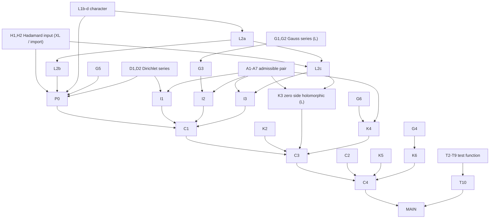

# Blueprint: the explicit-formula inequality `ExplicitFormulaBound`

Target (`Exp7Lean/Analytic/Statement.lean`, unchanged):

```lean
def ExplicitFormulaBound : Prop :=
  ∀ (q : ℕ) [Fact q.Prime], q % 4 = 3 → GRHFor q → ∀ (X : ℕ) (v : List ℝ), 2 ≤ X →
    (∃ t ∈ v, t ≠ 0) →
    primeSum q (autocorr (stepFn (log X) v)) X ≤
      log (q / π) + psi34 + Jterm (autocorr (stepFn (log X) v))
```

Status of this directory: **13 nodes proved, 40 leaves with `sorry`** (14 S, 20 M, 4 L, 2 XL), no
`axiom`. Every file compiles with `lake env lean` and reports only `declaration uses sorry`
warnings. `Main.lean` proves `Exp7.EF.explicitFormulaBound : ExplicitFormulaBound` from the leaves
(`#print axioms` shows `sorryAx` plus the three standard axioms). Nothing here is a proof of the
theorem until the leaves are filled.

How to check: `export PATH=$HOME/.elan/bin:$PATH`, then compile the files in import order
(`Defs, Character, HadamardInput, HadamardFallback, Zeros, Digamma, DirichletSeries, Pointwise,
Admissible, Pairing, DampedFormula, Continuation, TestFunction, Main`) with
`lake env lean -o .lake/build/lib/lean/Exp7Lean/Analytic/EF/<M>.olean Exp7Lean/Analytic/EF/<M>.lean`
(one process at a time; this is how they were checked). `lake build Exp7Lean.Analytic.EF.Main` should
also work but was not run here (it would start several Lean processes). The root `Exp7Lean.lean` was not
edited, so these modules are not part of the default target.

Contents: 1 strategy · 2 normalisations and numerical check · 3 what Mathlib has · 4 strategies
compared · 5 the proof · 6 dependency graph · 7 node list with exact Lean statements · 8 the Hadamard
input · 9 the community RH repository and Tau Ceti · 10 risks · 11 size.

---

## 1. Chosen strategy in one paragraph

Write `χ = chi q`, `m(ρ)` for the multiplicity of `ρ` as a zero of the completed L-function,
`f = autocorr g` and `h(t) = |ĝ(t)|²/∫g² ≥ 0` for its Fourier transform. The only deep input is the
**real-part Hadamard partial fraction** `Re Λ'/Λ(s,χ) + ½ log q = Σ_ρ m(ρ) Re 1/(s−ρ)` (H1, H2),
used **only where `Re s > 1`**. On the line `s = ½ + δ + it` with `δ > ½` every term is an absolutely
convergent series or integral, GRH turns the right side into a sum of Poisson kernels
`δ/(δ²+(t−γ)²)`, and integrating against `h(t) dt/π` gives a *damped* explicit formula
`Z(δ) = R(δ)` using nothing but Fubini/Tonelli and the inversion formula
`(1/2π)∫h(t)cos(tu)dt = f(u)`. Both sides are holomorphic in the damping parameter on `Re δ > 0`, so
the identity theorem extends `Z(δ) = R(δ)` to all `δ > 0`. Finally `Z(δ) ≥ 0` termwise and `R` is
continuous at `0⁺` with `R(0) = log(q/π) + ψ(3/4) + J_f − primeSum`, which is the inequality.
**No contour integral, no residue theorem, no bound for `L'/L` or `Γ'/Γ` in vertical strips, no
zero-counting, and no summation over zeros at `δ = 0` is needed.** The damping parameter does the
job that the contour shift does in the classical proof.

## 2. Normalisations (checked) and numerical sanity check

With `L = log X`, `g = stepFn L v`, `ĝ(t) = ∫ g(x) e^{itx} dx`:

| object | definition | Lean |
|---|---|---|
| `f` | `∫ g(x)g(x+u)dx / ∫g²`, even, supported in `[−L, L]`, `f(0)=1` | `autocorr g` |
| `h` | `∫ f(u) e^{itu} du = ĝ(t)·conj ĝ(t)/∫g²`; `f(u) = (1/2π)∫h(t)cos(tu)dt` | `hStep L v` |
| completed L | `Λ_q(s) = q^{s/2} π^{−(s+1)/2} Γ((s+1)/2) L(s,χ)` (`χ` odd) | `(q:ℂ)^(s/2) * (chi q).completedLFunction s` |
| log-derivative | `Λ_q'/Λ_q(s) = ½log(q/π) + ½ψ((s+1)/2) + L'/L(s)` | H1 + G5 |
| prime side | `2 Σ_{n<X} Λ(n)χ(n) f(log n) n^{−1/2−δ}` | `primeTermR q f X δ` (`= primeSum q f X` at `δ=0`) |
| archimedean | `Re ψ(3/4+δ/2) + ∫₀^∞ 2e^{−(3/2+δ)u}/(1−e^{−2u}) (1−f(u)) du` | `archTermR f δ` (`= psi34 + Jterm f` at `δ=0`) |
| zero side | `Σ_ρ m(ρ)·(1/π)∫ h(t) δ/(δ²+(t−Im ρ)²) dt` | `zeroSideR q h δ` |

The identity at `δ = 0` is the Guinand–Weil formula
`Σ_γ h(γ) = log(q/π) + ψ(3/4) + J_f − 2 Σ_{n<X} Λ(n)χ(n) f(log n)/√n`.

* The archimedean term: Gauss' formula gives
  `Re ψ(a+iτ) = ψ(a) + ∫₀^∞ e^{−aw}(1−cos τw)/(1−e^{−w}) dw`; with `a = 3/4`, `τ = t/2`, `w = 2u`
  and `(1/2π)∫h(t)(1−cos tu)dt = 1 − f(u)` one gets exactly `ψ(3/4) + J_f` (factor `2`, exponent
  `3/2` and denominator `1−e^{−2u}` as in `Jterm`).
* `ψ(3/4) = −γ + π/2 − 3 log 2` from reflection and duplication (`mpmath` agrees to 15 digits).
* **Formal check**: `arithSideR_zero` (K6, proved) shows that the blueprint's `δ = 0` right-hand side
  is literally `log (q/π) + psi34 + Jterm f − primeSum q f X` with the definitions of
  `Statement.lean` (modulo the leaf G4 `ψ(3/4) = psi34`).
* **Numerical check** (`numerics/ef_check.py`, `numerics/ef_damped.py`; zeros of `L(s,χ_{−q})` located
  on the critical line with `mpmath`):

  | case | zero side | arithmetic side | difference |
  |---|---|---|---|
  | `q=3, X=10`, smooth `g = sin²(πx/L)` (zeros to height 60) | `3.6741509e−5` | `3.6749480e−5` | `8e−9` |
  | `q=7, X=30`, smooth `g` (height 60) | `3.2454575e−3` | `3.2454591e−3` | `2e−9` |
  | `q=3, X=10, v=[1]` (height 120 + mean tail) | `0.070135` | `0.070076` | `−6e−5` |
  | `q=7, X=10, v=[1]` (height 100 + mean tail) | `0.309515` | `0.309685` | `2e−4` |
  | damped, `q=3, X=10, v=[1], δ=0.7` | `0.250793` | `0.250662` | `−1e−4` |
  | damped, `q=7, X=10, v=[1], δ=0.25` | `0.402522` | `0.402655` | `1e−4` |

  For the step function `h` decays only like `t⁻²`, so the truncated zero sum is completed by the
  mean-density tail; the residual `1e−4` is the size of that approximation. The smooth-`g` rows
  (where the tail is negligible) agree to about `1e−8` in absolute terms while the individual terms
  (`log(q/π)`, `ψ(3/4)`, `J_f`, the prime sum) have size `0.1–1.2`, which pins
  down `log(q/π)`, the sign and argument of `ψ`, the factor 2 in the prime sum and in `J`, and `√n`.

## 3. What Mathlib has and what it lacks (commit `31ce06ea`, tag `v4.37.0-rc1`)

All names below were checked with `#check` in this project.

**Present and used**

* Dirichlet L-functions: `DirichletCharacter.LFunction`, `completedLFunction`, `gammaFactor`,
  `Odd.gammaFactor_def`, `differentiable_completedLFunction`,
  `LFunction_eq_completed_div_gammaFactor`, functional equation
  `DirichletCharacter.IsPrimitive.completedLFunction_one_sub`, `rootNumber_ne_zero`, `norm_rootNumber`
  (`NumberTheory/LSeries/DirichletContinuation.lean`, `Nonvanishing.lean`);
  `LFunction_ne_zero_of_one_le_re` (`Nonvanishing.lean`).
* `−L'/L` as a Dirichlet series: `DirichletCharacter.LSeries_twist_vonMangoldt_eq`,
  `LSeriesSummable_twist_vonMangoldt`, `LFunction_eq_LSeries`, `deriv_LFunction_eq_deriv_LSeries`,
  `ArithmeticFunction.LSeriesSummable_vonMangoldt` (`NumberTheory/LSeries/Dirichlet.lean`).
* Digamma: `Complex.digamma` (`= logDeriv Gamma`), `digamma_one`, `digamma_one_half`,
  `digamma_apply_add_one`, `digamma_apply_add_nat`, `digamma_one_sub`, `digamma_two_mul`,
  `HasDerivAt.logDeriv_Gamma` (`Analysis/SpecialFunctions/Gamma/Digamma.lean`);
  `Real.convexOn_log_Gamma`; `Complex.Gammaℝ_def`, `Gammaℝ_ne_zero_of_re_pos`.
* Fourier analysis: inversion `Continuous.fourierInv_fourier_eq`,
  `MeasureTheory.Integrable.fourierInv_fourier_eq` (`Analysis/Fourier/Inversion.lean`); `L¹`
  convolution theorem `Real.fourier_mul_convolution_eq` (`Analysis/Fourier/Convolution.lean`);
  Mellin inversion `mellinInv_mellin_eq` (not needed).
* Complex analysis: identity theorem `AnalyticOnNhd.eqOn_of_preconnected_of_frequently_eq`,
  `DifferentiableOn.analyticOnNhd`, `differentiableOn_tsum_of_summable_norm`,
  `hasDerivAt_integral_of_dominated_loc_of_deriv_le`.
* For the in-house Hadamard fallback only: Jensen's formula
  `MeromorphicOn.circleAverage_log_norm`, `AnalyticOnNhd.circleAverage_log_norm`, Poisson–Jensen
  (`Analysis/Complex/JensenFormula.lean`), Schwarz/Herglotz kernel calculus
  `hasDerivAt_circleAverage_herglotzRieszKernel_smul` (`Analysis/Complex/Poisson.lean`),
  `Complex.borelCaratheodory`, Phragmén–Lindelöf
  (`PhragmenLindelof.right_half_plane_of_bounded_on_real`), Hadamard three lines
  (`Analysis/Complex/Hadamard.lean`), Cauchy–Goursat on rectangles and unbounded rectangles
  (`Complex.integral_boundary_rect_eq_zero_of_differentiable_on_off_countable`,
  `Complex.integral_boundary_unbounded_rect_eq_zero_of_differentiable_on_off_countable_of_integrable_on`),
  `LSeries_eq_mul_integral` (`NumberTheory/LSeries/SumCoeff.lean`).

**Absent** (grep over `Mathlib/`):

* Hadamard factorisation / canonical products / partial fractions of `Λ'/Λ` (the only hits for
  "Weierstrass" are power-series preparation and elliptic functions).
  `Analysis/Complex/Hadamard.lean` is the three-lines theorem, not factorisation.
* Any explicit formula, any sum over zeros of an L-function, zero counting `N(T)`.
  `NumberTheory/LSeries/ZetaZeros.lean` only proves discreteness of the zeros of `ζ`;
  `HardyZ.lean` only defines `Z(t)` for `ζ`; `RiemannZetaLogDeriv.lean` is the functional equation
  of `ζ'/ζ` only.
* A residue theorem (no `residue` in `Analysis/Complex`), growth of `L(s,χ)` or of `Γ`, `ψ` in
  vertical strips, Stirling for complex arguments, convexity bounds.
* Gauss' series and Gauss' integral for `ψ` (listed as TODO in `Digamma.lean`).

## 4. Strategies considered

| | route | what it needs beyond Mathlib | verdict |
|---|---|---|---|
| (a) | classical contour integral of `Λ'/Λ(s)·Φ(s)` over tall rectangles | residue theorem on rectangles with poles; zero counting in unit windows and a local partial fraction to bound `Λ'/Λ` on well-chosen horizontal segments (itself Hadamard or Borel–Carathéodory + Jensen); `ψ` in strips; convergence of `Σ_ρ Φ(ρ)` | most infrastructure; every item is absent |
| (b) | specialise to `f = g⋆g̃`, positivity as a pairing | a route through a smoothed truncated formula with error → 0 still needs (a)'s horizontal bounds; "Weil positivity as ⟨·,·⟩ ≥ 0" needs the spectral (zero) side anyway | no saving by itself — but the positivity `h ≥ 0` (`h` is a squared modulus) is what makes the damped argument close |
| (c) | Hadamard factorisation of `Λ_q` (order 1) → partial fractions of `Λ_q'/Λ_q` | Hadamard for order ≤ 1, growth of `Λ_q`, functional-equation pairing for `Re B(χ)` | **chosen as the single deep input**, in the weakest usable form (real part, `Re s > 1`); available verbatim in Tau Ceti |
| (d) | prove only the inequality | under GRH one can prove `Re Λ_q'/Λ_q ≥ 0` on `Re s > ½` without Hadamard (Phragmén–Lindelöf applied to `Λ_q(s−a)/Λ_q(s+a)`, needs Borel–Carathéodory lower bounds for `L` and a lower bound for the modulus of `Γ`), but passing from positivity on `Re s > ½` to the line needs the Poisson representation of a positive harmonic function on a half-plane and a boundary limit; estimated no cheaper than (c) and with more unknowns | rejected |
| **(c′)** | **(c) + analytic continuation in the damping parameter `δ`** | H1, H2 and elementary analysis | **chosen** |

Why (c′) beats "(c) + contour shift": once `Re Λ'/Λ = Σ m(ρ) Re 1/(s−ρ)` is known for `Re s > 1`,
the pairing with `h` is absolutely convergent on both sides there, and the passage to the critical
line is the identity theorem for two explicit holomorphic functions of `δ`. In the classical proof
the same passage is a contour shift through the critical strip and requires growth of `Λ'/Λ` there.

## 5. The proof

Fix `q ≡ 3 (4)` prime, assume GRH for `χ`, let `(f, h)` be admissible for `L = log X`:

```lean
structure WeilAdmissible (f : ℝ → ℝ) (L : ℝ) (h : ℝ → ℝ) : Prop where
  cont : Continuous h
  nonneg : ∀ t, 0 ≤ h t
  decay : ∃ C : ℝ, ∀ t, h t ≤ C / (1 + t ^ 2)
  inv : ∀ u, f u = 1 / (2 * π) * ∫ t, h t * Real.cos (t * u)
  zero : f 0 = 1
  supp : ∀ u, L ≤ u → f u = 0
```

Only the *cosine* transform appears because only real parts are paired; evenness of `h` is not
needed.

**Step 1 (pointwise, P0).** For `δ > ½`, `s = ½ + δ + it` has `Re s > 1`, so `L(s) ≠ 0` and H1
applies. With G5 (`γ'/γ(s) = ½ψ((s+1)/2) − ½log π`, `(s+1)/2 = ¾ + δ/2 + it/2`), D2
(`Re L'/L = −Σ Λ(n)χ(n) n^{−1/2−δ} cos(t log n)`) and GRH (`ρ = ½ + iγ` whenever `m(ρ) ≠ 0`, L2b):

`½ log(q/π) + ½ Re ψ(¾ + δ/2 + it/2) − Σ_n Λ(n)χ(n) n^{−1/2−δ} cos(t log n) = Σ_ρ m(ρ) δ/(δ²+(t−γ_ρ)²)`.

**Step 2 (pair with `h(t)dt`, I1–I3, A2).**
`∫h = 2π`; `∫ h·(Dirichlet series) = π·primeTermR` (Fubini, `Σ Λ(n) n^{−1/2−δ} < ∞`, inversion at
`u = log n`, `f(log n) = 0` for `n ≥ X`); `∫ h·Re ψ = 2π·archTermR` (Gauss' integral G3, Tonelli with
a nonnegative integrand); `∫ h·Σ_ρ = π·zeroSideR` (Tonelli). Hence **C1**: `zeroSideR q h δ =
arithSideR q f X δ` for `δ > ½`. (Proved in `DampedFormula.lean` from P0, I1–I3, A1, A2.)

**Step 3 (continuation, K1–K4, C3).** The complex versions `zeroSide q h`, `arithSide q f X` are
holomorphic on `Re δ > 0`: each zero term `(1/π)∫h(t) δ/(δ²+(t−γ)²)dt` is holomorphic and bounded by
`C/(1+γ²)` locally uniformly (A7), and `Σ m(ρ)/(1+γ²) < ∞` (L2c, from H2 at `s = 2`); `ψ(¾+δ/2)`,
the archimedean integral and the finite Dirichlet polynomial are holomorphic. They agree at the real
points `1 + 1/(n+1)`, so everywhere on `Re δ > 0`. (Proved in `Continuation.lean` from C1, K1–K4.)

**Step 4 (positivity and limit, C2, K5, K6, C4).** For real `δ > 0`, `zeroSideR q h δ ≥ 0` because
`m ≥ 0`, `h ≥ 0`, and the kernel is positive (proved). `arithSideR q f X δ → arithSideR q f X 0` as
`δ → 0⁺` (K5) and `arithSideR q f X 0 = log(q/π) + ψ(3/4) + J_f − primeSum q f X` (K6, proved). So
`primeSum ≤ log(q/π) + ψ(3/4) + J_f`. (Proved.)

**Step 5 (the test function, T1–T10).** `f = autocorr(stepFn L v)` is admissible with
`h = |ĝ|²/∫g²`: `h ≤ C/(1+t²)` because `g` is a step function, and inversion is
`Continuous.fourierInv_fourier_eq` applied to the correlation `c = g ⋆ g̃`, whose transform is `|ĝ|²`.

Remark. The full identity at `δ = 0` (`Σ_ρ m(ρ) h(γ_ρ) = …`) follows by one more dominated
convergence but is not needed for the inequality.

## 6. Dependency graph



**Critical path:** `H1/H2 → {P0, L2c} → C1 → C3 → C4 → MAIN`. H1/H2 is the only node whose in-house
cost is counted in thousands of lines. Among the rest the longest chains are
`G2 → G3 → I2 → C1` (Gauss' series and integral, then Tonelli) and `A7 → K3 → C3`.

**Independent work packages** (no shared unproved dependencies; each can be given to one agent):

1. `Character.lean` + `Zeros.lean` L2a (S/M, Mathlib only).
2. `Digamma.lean` G1–G3 (L), G4–G7 (S).
3. `DirichletSeries.lean` D1–D2 and `Pointwise.lean` P0 (uses H1 as a black box).
4. `Admissible.lean` A1–A7 (real analysis).
5. `Pairing.lean` I1, I3 (M) and I2 (L).
6. `Continuation.lean` K2, K4, K5 (M) and K3 (L).
7. `TestFunction.lean` T2–T6 (S/M), T9a, T9b (M), T9 (L).
8. `HadamardInput.lean` H1–H2: import (one line each) or `HadamardFallback.lean` (XL).
9. `Zeros.lean` L2c (uses H2 as a black box).

## 7. Nodes

Difficulty: S ≲ 40 lines, M ≈ 60–200, L ≈ 250–500, XL > 1500. "proved" means proved in the skeleton
from the listed dependencies (which may still contain `sorry`).

| id | Lean name | file | status | depends on | statement |
|---|---|---|---|---|---|
| **L1a** | `chi_apply_natCast` | `Character.lean` | proved | — | χ(n) = (n/q) as complex numbers. |
| **L1b** | `chi_ne_one` | `Character.lean` | S | — | χ ≠ 1. |
| **L1c** | `chi_isPrimitive` | `Character.lean` | M | L1b | χ is primitive (conductor divides the prime q and is not 1). |
| **L1d** | `chi_odd` | `Character.lean` | S | — | χ(−1) = −1 for q ≡ 3 (mod 4). |
| **H1** | `re_logDeriv_LFunction_add_eq_tsum` | `HadamardInput.lean` | XL (or import) | (HF1–HF6 if in-house) | For primitive χ ≠ 1 mod N, Re s > 0, L(s,χ) ≠ 0:  Re L'/L(s) + ½ log N + Re γ'/γ(s) = Σ_ρ m_ρ Re 1/(s−ρ). |
| **H2** | `summable_norm_analyticOrderNatAt_completedLFunction_mul_re_one_div_sub` | `HadamardInput.lean` | XL (or import) | (HF1–HF6 if in-house) | Σ_ρ \|m_ρ Re 1/(s−ρ)\| < ∞ for every s. |
| **L2a** | `mult_ne_zero_imp` | `Zeros.lean` | M | L1b, L1c, L1d | m(ρ) ≠ 0 ⇒ 0 < Re ρ < 1 and L(ρ,χ) = 0. |
| **L2b** | `re_eq_half_of_mult_ne_zero` | `Zeros.lean` | proved | L2a | Under GRH: m(ρ) ≠ 0 ⇒ Re ρ = ½. |
| **L2c** | `summable_mult_div` | `Zeros.lean` | M | H2, L2a, L1b, L1c | Σ_ρ m(ρ)/(1+(Im ρ)²) < ∞. |
| **G1** | `summable_gaussSeries` | `Digamma.lean` | M | — | Σ_n (1/(n+1) − 1/(s+n)) converges absolutely. |
| **G2** | `digamma_eq_gaussSeries` | `Digamma.lean` | L | G1, G6 | ψ(s) = −γ + Σ_n (1/(n+1) − 1/(s+n)) off the poles. |
| **G3a** | `integrableOn_gaussKernel` | `Digamma.lean` | M | — | e^{−aw}(1−cos τw)/(1−e^{−w}) is integrable on (0,∞), a > 0. |
| **G3** | `re_digamma_add_mul_I_sub` | `Digamma.lean` | M | G1, G2, G3a | Re ψ(a+iτ) − ψ(a) = ∫₀^∞ e^{−aw}(1−cos τw)/(1−e^{−w}) dw, a > 0. |
| **G4** | `digamma_three_quarters` | `Digamma.lean` | S | — | ψ(3/4) = −γ + π/2 − 3 log 2 (= `psi34`). |
| **G5** | `logDeriv_gammaFactor_odd` | `Digamma.lean` | S | — | For odd χ, Re s > 0: γ'/γ(s) = ½ψ((s+1)/2) − ½ log π. |
| **G6** | `analyticOnNhd_digamma_re_pos` | `Digamma.lean` | S | — | ψ is analytic on Re s > 0. |
| **G7** | `digamma_ofReal_im` | `Digamma.lean` | S | — | ψ(x) is real for real x > 0. |
| **D1** | `summable_abs_coeff_mul_rpow` | `DirichletSeries.lean` | S | — | Σ_n \|Λ(n)χ(n)\| n^{−1/2−δ} < ∞ for δ > ½. |
| **D2** | `re_logDeriv_LFunction` | `DirichletSeries.lean` | M | L1a, D1 | Re L'/L(½+δ+it, χ) = −Σ_n Λ(n)χ(n) n^{−1/2−δ} cos(t log n), δ > ½. |
| **P0** | `pointwise_identity` | `Pointwise.lean` | M | H1, L1b–d, L2b, G5, D2 | Under GRH, δ > ½: ½log(q/π) + ½Re ψ(¾+δ/2+it/2) − Σ_n Λχ n^{−1/2−δ}cos(t log n) = Σ_ρ m(ρ) δ/(δ²+(t−Im ρ)²). |
| **A1** | `WeilAdmissible.integrable` | `Admissible.lean` | S | — | h ∈ L¹(ℝ). |
| **A2** | `WeilAdmissible.integral_eq` | `Admissible.lean` | S | — | ∫ h = 2π. |
| **A3** | `WeilAdmissible.one_sub_nonneg` | `Admissible.lean` | S | A1, A2 | 0 ≤ 1 − f(u). |
| **A4** | `WeilAdmissible.one_sub_le` | `Admissible.lean` | M | A1, A2 | 1 − f(u) ≤ C\|u\|. |
| **A5** | `WeilAdmissible.continuous` | `Admissible.lean` | S | A1 | f is continuous. |
| **A6** | `WeilAdmissible.integrableOn_archIntegrand` | `Admissible.lean` | M | A3, A4, A5 | u ↦ 2e^{−(3/2+δ)u}(1−f(u))/(1−e^{−2u}) is integrable on (0,∞), δ ≥ 0. |
| **A7** | `WeilAdmissible.exists_poisson_bound` | `Admissible.lean` | M | A1 | Uniformly for a ≤ Re δ, \|δ\| ≤ b: ∫ h(t)\|δ/(δ²+(t−γ)²)\| dt ≤ C/(1+γ²). |
| **I1** | `integral_h_mul_dirichletR` | `Pairing.lean` | M | A1, D1 | ∫ h(t) Σ_n Λχ n^{−1/2−δ}cos(t log n) dt = π·primeTermR (δ > ½). |
| **I2** | `integral_h_mul_re_digamma` | `Pairing.lean` | L | G3, G3a, A1–A6 | ∫ h(t) Re ψ(¾+δ/2+it/2) dt = 2π·archTermR f δ (δ ≥ 0). |
| **I3** | `integral_h_mul_zerosKer` | `Pairing.lean` | M | A1, A7, L2c | ∫ h(t) Σ_ρ m(ρ)δ/(δ²+(t−Im ρ)²) dt = π·zeroSideR q h δ (δ > 0). |
| **C1** | `zeroSideR_eq_arithSideR_of_half_lt` | `DampedFormula.lean` | proved | P0, I1, I2, I3, A1, A2 | Damped explicit formula for δ > ½ (under GRH): zeroSideR = arithSideR. |
| **K1** | `zeroSide_ofReal` | `Continuation.lean` | proved | — | zeroSide(δ) = zeroSideR(δ) for real δ. |
| **K2** | `arithSide_ofReal` | `Continuation.lean` | M | G7 | arithSide(δ) = arithSideR(δ) for real δ ≥ 0. |
| **K3** | `differentiableOn_zeroSide` | `Continuation.lean` | L | A7, L2c | δ ↦ zeroSide q h δ is holomorphic on Re δ > 0. |
| **K4** | `differentiableOn_arithSide` | `Continuation.lean` | M | G6, A3, A4, A5 | δ ↦ arithSide q f X δ is holomorphic on Re δ > 0. |
| **K5** | `tendsto_arithSideR` | `Continuation.lean` | M | A6, G6 | arithSideR(δ) → arithSideR(0) as δ → 0⁺. |
| **K6** | `arithSideR_zero` | `Continuation.lean` | proved | G4 | arithSideR(0) = log(q/π) + ψ(3/4) + J_f − primeSum q f X. |
| **C2** | `zeroSideR_nonneg` | `Continuation.lean` | proved | — | zeroSideR(δ) ≥ 0 for δ ≥ 0. |
| **C3** | `zeroSideR_eq_arithSideR` | `Continuation.lean` | proved | C1, K1, K2, K3, K4 | Damped explicit formula for every δ > 0 (under GRH). |
| **C4** | `primeSum_le_of_weilAdmissible` | `Continuation.lean` | proved | C2, C3, K5, K6 | For admissible (f,h), under GRH: primeSum q f X ≤ log(q/π) + ψ(3/4) + J_f. |
| **T1** | `stepFn_eq_zero` | `TestFunction.lean` | proved | — | g = 0 outside [0, L). |
| **T2** | `measurable_stepFn` | `TestFunction.lean` | S | — | g is measurable. |
| **T3** | `abs_stepFn_le` | `TestFunction.lean` | S | — | g is bounded. |
| **T4** | `integral_stepFn_sq_pos` | `TestFunction.lean` | M | T2 | ∫ g² > 0 if L > 0 and some v_i ≠ 0. |
| **T5** | `hStep_decay` | `TestFunction.lean` | M | T1–T3 | h(t) = \|ĝ(t)\|²/∫g² ≤ C/(1+t²). |
| **T6** | `continuous_hStep` | `TestFunction.lean` | S | T1–T3 | h is continuous. |
| **T7** | `autocorr_stepFn_zero` | `TestFunction.lean` | proved | T4 | autocorr g 0 = 1. |
| **T8** | `autocorr_stepFn_eq_zero` | `TestFunction.lean` | proved | T1 | autocorr g u = 0 for u ≥ L. |
| **T9a** | `continuous_integrable_corr` | `TestFunction.lean` | M | T1–T3 | c(u) = ∫ g(x)g(x+u)dx is continuous and integrable. |
| **T9b** | `integral_corr_mul_exp` | `TestFunction.lean` | M | T1–T3 | ∫ c(u)e^{itu}du = \|ĝ(t)\|². |
| **T9** | `autocorr_stepFn_inv` | `TestFunction.lean` | L | T5, T9a, T9b | autocorr g u = (1/2π)∫ h(t)cos(tu)dt. |
| **T10** | `weilAdmissible_autocorr_stepFn` | `TestFunction.lean` | proved | T4–T9 | autocorr(stepFn L v) is admissible with h = hStep L v. |
| **MAIN** | `explicitFormulaBound` | `Main.lean` | proved | C4, T10 | `ExplicitFormulaBound`. |


### Exact Lean statements

All statements live in `namespace Exp7.EF`; the definitions (`mult`, `coeff`, `poissonKer`,
`zerosKer`, `dirichletR`, `zeroSideR`, `archIntegrand`, `archTermR`, `primeTermR`, `arithSideR`,
`zeroSide`, `archTerm`, `primeTerm`, `arithSide`, `rightHalfPlane`) are in `Defs.lean`;
`ftStep`, `hStep` in `TestFunction.lean`.

#### L1a — `chi_apply_natCast` (proved)

*File:* `Exp7Lean/Analytic/EF/Character.lean`.  *Depends on:* —.

*Statement:* χ(n) = (n/q) as complex numbers.

```lean
theorem chi_apply_natCast (n : ℕ) : chi q (n : ZMod q) = (legendreSym q n : ℂ)
```

#### L1b — `chi_ne_one` (S)

*File:* `Exp7Lean/Analytic/EF/Character.lean`.  *Depends on:* —.

*Statement:* χ ≠ 1.

*Entry points:* `quadraticChar_exists_neg_one`, `ZMod.ringChar_zmod_n`

```lean
theorem chi_ne_one (hq : q % 4 = 3) : chi q ≠ 1
```

#### L1c — `chi_isPrimitive` (M)

*File:* `Exp7Lean/Analytic/EF/Character.lean`.  *Depends on:* L1b.

*Statement:* χ is primitive (conductor divides the prime q and is not 1).

*Entry points:* `DirichletCharacter.conductor_dvd_level`, `DirichletCharacter.eq_one_iff_conductor_eq_one`, `DirichletCharacter.isPrimitive_def`, `Nat.Prime.eq_one_or_self_of_dvd`

```lean
theorem chi_isPrimitive (hq : q % 4 = 3) : (chi q).IsPrimitive
```

#### L1d — `chi_odd` (S)

*File:* `Exp7Lean/Analytic/EF/Character.lean`.  *Depends on:* —.

*Statement:* χ(−1) = −1 for q ≡ 3 (mod 4).

*Entry points:* `quadraticChar_neg_one`, `ZMod.χ₄_nat_three_mod_four`, `ZMod.card`

```lean
theorem chi_odd (hq : q % 4 = 3) : (chi q).Odd
```

#### H1 — `re_logDeriv_LFunction_add_eq_tsum` (XL (or import))

*File:* `Exp7Lean/Analytic/EF/HadamardInput.lean`.  *Depends on:* (HF1–HF6 if in-house).

*Statement:* For primitive χ ≠ 1 mod N, Re s > 0, L(s,χ) ≠ 0:  Re L'/L(s) + ½ log N + Re γ'/γ(s) = Σ_ρ m_ρ Re 1/(s−ρ).

*Entry points:* TauCeti `DirichletCharacter.re_logDeriv_LFunction_add_eq_tsum` (verbatim); in-house: `HadamardFallback.lean`

```lean
theorem re_logDeriv_LFunction_add_eq_tsum (hχ : χ.IsPrimitive) (hne : χ ≠ 1) {s : ℂ}
    (hs : 0 < s.re) (hL : χ.LFunction s ≠ 0) :
    (logDeriv χ.LFunction s).re + Real.log N / 2 + (logDeriv χ.gammaFactor s).re =
      ∑' ρ : ℂ, (analyticOrderNatAt χ.completedLFunction ρ : ℝ) * (1 / (s - ρ)).re
```

#### H2 — `summable_norm_analyticOrderNatAt_completedLFunction_mul_re_one_div_sub` (XL (or import))

*File:* `Exp7Lean/Analytic/EF/HadamardInput.lean`.  *Depends on:* (HF1–HF6 if in-house).

*Statement:* Σ_ρ |m_ρ Re 1/(s−ρ)| < ∞ for every s.

*Entry points:* TauCeti, same file, same name (verbatim)

```lean
theorem summable_norm_analyticOrderNatAt_completedLFunction_mul_re_one_div_sub
    (hχ : χ.IsPrimitive) (hne : χ ≠ 1) (s : ℂ) :
    Summable (fun ρ : ℂ ↦
      ‖(analyticOrderNatAt χ.completedLFunction ρ : ℝ) * (1 / (s - ρ)).re‖)
```

#### L2a — `mult_ne_zero_imp` (M)

*File:* `Exp7Lean/Analytic/EF/Zeros.lean`.  *Depends on:* L1b, L1c, L1d.

*Statement:* m(ρ) ≠ 0 ⇒ 0 < Re ρ < 1 and L(ρ,χ) = 0.

*Entry points:* `DirichletCharacter.IsPrimitive.completedLFunction_one_sub`, `DirichletCharacter.rootNumber_ne_zero`, `DirichletCharacter.LFunction_eq_completed_div_gammaFactor`, `DirichletCharacter.LFunction_ne_zero_of_one_le_re`, `Complex.Gammaℝ_ne_zero_of_re_pos`, `DirichletCharacter.differentiable_completedLFunction`, `AnalyticAt.analyticOrderAt_eq_zero`

```lean
theorem mult_ne_zero_imp (hq : q % 4 = 3) {ρ : ℂ} (h : mult q ρ ≠ 0) :
    0 < ρ.re ∧ ρ.re < 1 ∧ (chi q).LFunction ρ = 0
```

#### L2b — `re_eq_half_of_mult_ne_zero` (proved)

*File:* `Exp7Lean/Analytic/EF/Zeros.lean`.  *Depends on:* L2a.

*Statement:* Under GRH: m(ρ) ≠ 0 ⇒ Re ρ = ½.

```lean
theorem re_eq_half_of_mult_ne_zero (hq : q % 4 = 3) (hGRH : GRHFor q) {ρ : ℂ}
    (h : mult q ρ ≠ 0) : ρ.re = 1 / 2
```

#### L2c — `summable_mult_div` (M)

*File:* `Exp7Lean/Analytic/EF/Zeros.lean`.  *Depends on:* H2, L2a, L1b, L1c.

*Statement:* Σ_ρ m(ρ)/(1+(Im ρ)²) < ∞.

*Entry points:* H2 at s = 2, `Summable.of_nonneg_of_le`

```lean
theorem summable_mult_div (hq : q % 4 = 3) :
    Summable (fun ρ : ℂ ↦ (mult q ρ : ℝ) / (1 + ρ.im ^ 2))
```

#### G1 — `summable_gaussSeries` (M)

*File:* `Exp7Lean/Analytic/EF/Digamma.lean`.  *Depends on:* —.

*Statement:* Σ_n (1/(n+1) − 1/(s+n)) converges absolutely.

*Entry points:* TauCeti `Complex.summable_gaussSeries`; `Real.summable_one_div_nat_pow`

```lean
theorem summable_gaussSeries (s : ℂ) :
    Summable (fun n : ℕ ↦ 1 / ((n : ℂ) + 1) - 1 / (s + n))
```

#### G2 — `digamma_eq_gaussSeries` (L)

*File:* `Exp7Lean/Analytic/EF/Digamma.lean`.  *Depends on:* G1, G6.

*Statement:* ψ(s) = −γ + Σ_n (1/(n+1) − 1/(s+n)) off the poles.

*Entry points:* TauCeti `Complex.digamma_eq_gaussSeries`; Mathlib `Complex.digamma_apply_add_one`, `Complex.digamma_one`, `Real.convexOn_log_Gamma`, identity theorem

```lean
theorem digamma_eq_gaussSeries {s : ℂ} (hs : ∀ m : ℕ, s ≠ -(m : ℂ)) :
    digamma s = -Real.eulerMascheroniConstant +
      ∑' n : ℕ, (1 / ((n : ℂ) + 1) - 1 / (s + n))
```

#### G3a — `integrableOn_gaussKernel` (M)

*File:* `Exp7Lean/Analytic/EF/Digamma.lean`.  *Depends on:* —.

*Statement:* e^{−aw}(1−cos τw)/(1−e^{−w}) is integrable on (0,∞), a > 0.

*Entry points:* `integrableOn_exp_mul_Ioi`, `Real.one_sub_sq_div_two_le_cos`

```lean
theorem integrableOn_gaussKernel {a : ℝ} (ha : 0 < a) (τ : ℝ) :
    IntegrableOn (fun w : ℝ ↦ Real.exp (-a * w) * (1 - Real.cos (τ * w)) / (1 - Real.exp (-w)))
      (Set.Ioi 0)
```

#### G3 — `re_digamma_add_mul_I_sub` (M)

*File:* `Exp7Lean/Analytic/EF/Digamma.lean`.  *Depends on:* G1, G2, G3a.

*Statement:* Re ψ(a+iτ) − ψ(a) = ∫₀^∞ e^{−aw}(1−cos τw)/(1−e^{−w}) dw, a > 0.

*Entry points:* `MeasureTheory.integral_tsum` / `lintegral_tsum`, `integral_exp_mul_Ioi`

```lean
theorem re_digamma_add_mul_I_sub {a : ℝ} (ha : 0 < a) (τ : ℝ) :
    (digamma ((a : ℂ) + (τ : ℂ) * I)).re - (digamma (a : ℂ)).re =
      ∫ w in Set.Ioi (0 : ℝ),
        Real.exp (-a * w) * (1 - Real.cos (τ * w)) / (1 - Real.exp (-w))
```

#### G4 — `digamma_three_quarters` (S)

*File:* `Exp7Lean/Analytic/EF/Digamma.lean`.  *Depends on:* —.

*Statement:* ψ(3/4) = −γ + π/2 − 3 log 2 (= `psi34`).

*Entry points:* `Complex.digamma_one_sub`, `Complex.digamma_two_mul`, `Complex.digamma_one_half`

```lean
theorem digamma_three_quarters : digamma ((3 / 4 : ℝ) : ℂ) = (psi34 : ℂ)
```

#### G5 — `logDeriv_gammaFactor_odd` (S)

*File:* `Exp7Lean/Analytic/EF/Digamma.lean`.  *Depends on:* —.

*Statement:* For odd χ, Re s > 0: γ'/γ(s) = ½ψ((s+1)/2) − ½ log π.

*Entry points:* `DirichletCharacter.Odd.gammaFactor_def`, `Complex.Gammaℝ_def`, `HasDerivAt.logDeriv_Gamma`; TauCeti `Complex.logDeriv_Gammaℝ`

```lean
theorem logDeriv_gammaFactor_odd {N : ℕ} [NeZero N] {χ : DirichletCharacter ℂ N} (hχ : χ.Odd)
    {s : ℂ} (hs : 0 < s.re) :
    logDeriv χ.gammaFactor s = digamma ((s + 1) / 2) / 2 - (Real.log Real.pi : ℂ) / 2
```

#### G6 — `analyticOnNhd_digamma_re_pos` (S)

*File:* `Exp7Lean/Analytic/EF/Digamma.lean`.  *Depends on:* —.

*Statement:* ψ is analytic on Re s > 0.

*Entry points:* `Complex.differentiableAt_Gamma`, `Complex.Gamma_ne_zero_of_re_pos`, `DifferentiableOn.analyticOnNhd`; TauCeti `Complex.analyticOnNhd_digamma_re_pos`

```lean
theorem analyticOnNhd_digamma_re_pos : AnalyticOnNhd ℂ digamma {s : ℂ | 0 < s.re}
```

#### G7 — `digamma_ofReal_im` (S)

*File:* `Exp7Lean/Analytic/EF/Digamma.lean`.  *Depends on:* —.

*Statement:* ψ(x) is real for real x > 0.

*Entry points:* `Complex.Gamma_conj`, or G2

```lean
theorem digamma_ofReal_im {x : ℝ} (hx : 0 < x) : (digamma (x : ℂ)).im = 0
```

#### D1 — `summable_abs_coeff_mul_rpow` (S)

*File:* `Exp7Lean/Analytic/EF/DirichletSeries.lean`.  *Depends on:* —.

*Statement:* Σ_n |Λ(n)χ(n)| n^{−1/2−δ} < ∞ for δ > ½.

*Entry points:* `ArithmeticFunction.LSeriesSummable_vonMangoldt`

```lean
theorem summable_abs_coeff_mul_rpow {δ : ℝ} (hδ : 1 / 2 < δ) :
    Summable (fun n : ℕ ↦ |coeff q n| * (n : ℝ) ^ (-(1 / 2 : ℝ) - δ))
```

#### D2 — `re_logDeriv_LFunction` (M)

*File:* `Exp7Lean/Analytic/EF/DirichletSeries.lean`.  *Depends on:* L1a, D1.

*Statement:* Re L'/L(½+δ+it, χ) = −Σ_n Λ(n)χ(n) n^{−1/2−δ} cos(t log n), δ > ½.

*Entry points:* `DirichletCharacter.LSeries_twist_vonMangoldt_eq`, `DirichletCharacter.LSeriesSummable_twist_vonMangoldt`, `DirichletCharacter.LFunction_eq_LSeries`, `DirichletCharacter.deriv_LFunction_eq_deriv_LSeries`

```lean
theorem re_logDeriv_LFunction (δ : ℝ) (hδ : 1 / 2 < δ) (t : ℝ) :
    (logDeriv (chi q).LFunction (((1 / 2 + δ : ℝ) : ℂ) + (t : ℂ) * I)).re = -dirichletR q δ t
```

#### P0 — `pointwise_identity` (M)

*File:* `Exp7Lean/Analytic/EF/Pointwise.lean`.  *Depends on:* H1, L1b–d, L2b, G5, D2.

*Statement:* Under GRH, δ > ½: ½log(q/π) + ½Re ψ(¾+δ/2+it/2) − Σ_n Λχ n^{−1/2−δ}cos(t log n) = Σ_ρ m(ρ) δ/(δ²+(t−Im ρ)²).

*Entry points:* `DirichletCharacter.LFunction_ne_zero_of_one_le_re`, `Real.log_div`

```lean
theorem pointwise_identity (hq : q % 4 = 3) (hGRH : GRHFor q) {δ : ℝ} (hδ : 1 / 2 < δ) (t : ℝ) :
    Real.log (q / Real.pi) / 2
        + (digamma (((3 / 4 + δ / 2 : ℝ) : ℂ) + ((t / 2 : ℝ) : ℂ) * I)).re / 2
        - dirichletR q δ t
      = zerosKer q δ t
```

#### A1 — `WeilAdmissible.integrable` (S)

*File:* `Exp7Lean/Analytic/EF/Admissible.lean`.  *Depends on:* —.

*Statement:* h ∈ L¹(ℝ).

*Entry points:* `integrable_inv_one_add_sq`, `Integrable.mono'`

```lean
theorem WeilAdmissible.integrable (hf : WeilAdmissible f L h) : Integrable h
```

#### A2 — `WeilAdmissible.integral_eq` (S)

*File:* `Exp7Lean/Analytic/EF/Admissible.lean`.  *Depends on:* —.

*Statement:* ∫ h = 2π.

*Entry points:* fields `inv`, `zero`

```lean
theorem WeilAdmissible.integral_eq (hf : WeilAdmissible f L h) : ∫ t, h t = 2 * π
```

#### A3 — `WeilAdmissible.one_sub_nonneg` (S)

*File:* `Exp7Lean/Analytic/EF/Admissible.lean`.  *Depends on:* A1, A2.

*Statement:* 0 ≤ 1 − f(u).

*Entry points:* `integral_nonneg`, `Real.cos_le_one`

```lean
theorem WeilAdmissible.one_sub_nonneg (hf : WeilAdmissible f L h) (u : ℝ) : 0 ≤ 1 - f u
```

#### A4 — `WeilAdmissible.one_sub_le` (M)

*File:* `Exp7Lean/Analytic/EF/Admissible.lean`.  *Depends on:* A1, A2.

*Statement:* 1 − f(u) ≤ C|u|.

*Entry points:* `Real.one_sub_sq_div_two_le_cos`

```lean
theorem WeilAdmissible.one_sub_le (hf : WeilAdmissible f L h) :
    ∃ C : ℝ, ∀ u, 1 - f u ≤ C * |u|
```

#### A5 — `WeilAdmissible.continuous` (S)

*File:* `Exp7Lean/Analytic/EF/Admissible.lean`.  *Depends on:* A1.

*Statement:* f is continuous.

*Entry points:* `MeasureTheory.continuous_of_dominated`

```lean
theorem WeilAdmissible.continuous (hf : WeilAdmissible f L h) : Continuous f
```

#### A6 — `WeilAdmissible.integrableOn_archIntegrand` (M)

*File:* `Exp7Lean/Analytic/EF/Admissible.lean`.  *Depends on:* A3, A4, A5.

*Statement:* u ↦ 2e^{−(3/2+δ)u}(1−f(u))/(1−e^{−2u}) is integrable on (0,∞), δ ≥ 0.

*Entry points:* `integrableOn_exp_mul_Ioi`

```lean
theorem WeilAdmissible.integrableOn_archIntegrand (hf : WeilAdmissible f L h) {δ : ℝ}
    (hδ : 0 ≤ δ) : IntegrableOn (archIntegrand f δ) (Set.Ioi 0)
```

#### A7 — `WeilAdmissible.exists_poisson_bound` (M)

*File:* `Exp7Lean/Analytic/EF/Admissible.lean`.  *Depends on:* A1.

*Statement:* Uniformly for a ≤ Re δ, |δ| ≤ b: ∫ h(t)|δ/(δ²+(t−γ)²)| dt ≤ C/(1+γ²).

*Entry points:* `integrable_inv_one_add_sq`

```lean
theorem WeilAdmissible.exists_poisson_bound (hf : WeilAdmissible f L h) {a b : ℝ} (ha : 0 < a) :
    ∃ C : ℝ, ∀ δ : ℂ, a ≤ δ.re → ‖δ‖ ≤ b → ∀ γ : ℝ,
      Integrable (fun t : ℝ ↦ (h t : ℂ) * (δ / (δ ^ 2 + ((t - γ : ℝ) : ℂ) ^ 2))) ∧
      ∫ t : ℝ, h t * ‖δ / (δ ^ 2 + ((t - γ : ℝ) : ℂ) ^ 2)‖ ≤ C / (1 + γ ^ 2)
```

#### I1 — `integral_h_mul_dirichletR` (M)

*File:* `Exp7Lean/Analytic/EF/Pairing.lean`.  *Depends on:* A1, D1.

*Statement:* ∫ h(t) Σ_n Λχ n^{−1/2−δ}cos(t log n) dt = π·primeTermR (δ > ½).

*Entry points:* `MeasureTheory.integral_tsum_of_summable_integral_norm`

```lean
theorem integral_h_mul_dirichletR (hf : WeilAdmissible f (Real.log X) h) {δ : ℝ}
    (hδ : 1 / 2 < δ) :
    Integrable (fun t ↦ h t * dirichletR q δ t) ∧
      ∫ t, h t * dirichletR q δ t = π * primeTermR q f X δ
```

#### I2 — `integral_h_mul_re_digamma` (L)

*File:* `Exp7Lean/Analytic/EF/Pairing.lean`.  *Depends on:* G3, G3a, A1–A6.

*Statement:* ∫ h(t) Re ψ(¾+δ/2+it/2) dt = 2π·archTermR f δ (δ ≥ 0).

*Entry points:* `MeasureTheory.integral_integral_swap`, `integral_comp_mul_left_Ioi`

```lean
theorem integral_h_mul_re_digamma {L : ℝ} (hf : WeilAdmissible f L h) {δ : ℝ} (hδ : 0 ≤ δ) :
    Integrable (fun t : ℝ ↦
        h t * (digamma (((3 / 4 + δ / 2 : ℝ) : ℂ) + ((t / 2 : ℝ) : ℂ) * I)).re) ∧
      ∫ t : ℝ, h t * (digamma (((3 / 4 + δ / 2 : ℝ) : ℂ) + ((t / 2 : ℝ) : ℂ) * I)).re
        = 2 * π * archTermR f δ
```

#### I3 — `integral_h_mul_zerosKer` (M)

*File:* `Exp7Lean/Analytic/EF/Pairing.lean`.  *Depends on:* A1, A7, L2c.

*Statement:* ∫ h(t) Σ_ρ m(ρ)δ/(δ²+(t−Im ρ)²) dt = π·zeroSideR q h δ (δ > 0).

*Entry points:* `MeasureTheory.lintegral_tsum`, `Summable.countable_support`

```lean
theorem integral_h_mul_zerosKer {L : ℝ} (hq : q % 4 = 3) (hf : WeilAdmissible f L h) {δ : ℝ}
    (hδ : 0 < δ) :
    Integrable (fun t ↦ h t * zerosKer q δ t) ∧
      ∫ t, h t * zerosKer q δ t = π * zeroSideR q h δ
```

#### C1 — `zeroSideR_eq_arithSideR_of_half_lt` (proved)

*File:* `Exp7Lean/Analytic/EF/DampedFormula.lean`.  *Depends on:* P0, I1, I2, I3, A1, A2.

*Statement:* Damped explicit formula for δ > ½ (under GRH): zeroSideR = arithSideR.

```lean
theorem zeroSideR_eq_arithSideR_of_half_lt (hq : q % 4 = 3) (hGRH : GRHFor q)
    (hf : WeilAdmissible f (Real.log X) h) {δ : ℝ} (hδ : 1 / 2 < δ) :
    zeroSideR q h δ = arithSideR q f X δ
```

#### K1 — `zeroSide_ofReal` (proved)

*File:* `Exp7Lean/Analytic/EF/Continuation.lean`.  *Depends on:* —.

*Statement:* zeroSide(δ) = zeroSideR(δ) for real δ.

```lean
theorem zeroSide_ofReal (δ : ℝ) : zeroSide q h (δ : ℂ) = (zeroSideR q h δ : ℂ)
```

#### K2 — `arithSide_ofReal` (M)

*File:* `Exp7Lean/Analytic/EF/Continuation.lean`.  *Depends on:* G7.

*Statement:* arithSide(δ) = arithSideR(δ) for real δ ≥ 0.

*Entry points:* `integral_complex_ofReal`, `Complex.ofReal_cpow`

```lean
theorem arithSide_ofReal {δ : ℝ} (hδ : 0 ≤ δ) :
    arithSide q f X (δ : ℂ) = (arithSideR q f X δ : ℂ)
```

#### K3 — `differentiableOn_zeroSide` (L)

*File:* `Exp7Lean/Analytic/EF/Continuation.lean`.  *Depends on:* A7, L2c.

*Statement:* δ ↦ zeroSide q h δ is holomorphic on Re δ > 0.

*Entry points:* `differentiableOn_tsum_of_summable_norm`, `hasDerivAt_integral_of_dominated_loc_of_deriv_le`; TauCeti `Analysis/Complex/ParametricIntegralHolomorphy.lean`

```lean
theorem differentiableOn_zeroSide {L : ℝ} (hq : q % 4 = 3) (hf : WeilAdmissible f L h) :
    DifferentiableOn ℂ (zeroSide q h) rightHalfPlane
```

#### K4 — `differentiableOn_arithSide` (M)

*File:* `Exp7Lean/Analytic/EF/Continuation.lean`.  *Depends on:* G6, A3, A4, A5.

*Statement:* δ ↦ arithSide q f X δ is holomorphic on Re δ > 0.

*Entry points:* `hasDerivAt_integral_of_dominated_loc_of_deriv_le`

```lean
theorem differentiableOn_arithSide {L : ℝ} (hf : WeilAdmissible f L h) :
    DifferentiableOn ℂ (arithSide q f X) rightHalfPlane
```

#### K5 — `tendsto_arithSideR` (M)

*File:* `Exp7Lean/Analytic/EF/Continuation.lean`.  *Depends on:* A6, G6.

*Statement:* arithSideR(δ) → arithSideR(0) as δ → 0⁺.

*Entry points:* `MeasureTheory.tendsto_integral_filter_of_dominated_convergence`

```lean
theorem tendsto_arithSideR {L : ℝ} (hf : WeilAdmissible f L h) :
    Tendsto (arithSideR q f X) (𝓝[>] 0) (𝓝 (arithSideR q f X 0))
```

#### K6 — `arithSideR_zero` (proved)

*File:* `Exp7Lean/Analytic/EF/Continuation.lean`.  *Depends on:* G4.

*Statement:* arithSideR(0) = log(q/π) + ψ(3/4) + J_f − primeSum q f X.

```lean
theorem arithSideR_zero :
    arithSideR q f X 0 = Real.log (q / π) + psi34 + Jterm f - primeSum q f X
```

#### C2 — `zeroSideR_nonneg` (proved)

*File:* `Exp7Lean/Analytic/EF/Continuation.lean`.  *Depends on:* —.

*Statement:* zeroSideR(δ) ≥ 0 for δ ≥ 0.

```lean
theorem zeroSideR_nonneg {L : ℝ} (hf : WeilAdmissible f L h) {δ : ℝ} (hδ : 0 ≤ δ) :
    0 ≤ zeroSideR q h δ
```

#### C3 — `zeroSideR_eq_arithSideR` (proved)

*File:* `Exp7Lean/Analytic/EF/Continuation.lean`.  *Depends on:* C1, K1, K2, K3, K4.

*Statement:* Damped explicit formula for every δ > 0 (under GRH).

*Entry points:* `AnalyticOnNhd.eqOn_of_preconnected_of_frequently_eq`

```lean
theorem zeroSideR_eq_arithSideR (hq : q % 4 = 3) (hGRH : GRHFor q)
    (hf : WeilAdmissible f (Real.log X) h) {δ : ℝ} (hδ : 0 < δ) :
    zeroSideR q h δ = arithSideR q f X δ
```

#### C4 — `primeSum_le_of_weilAdmissible` (proved)

*File:* `Exp7Lean/Analytic/EF/Continuation.lean`.  *Depends on:* C2, C3, K5, K6.

*Statement:* For admissible (f,h), under GRH: primeSum q f X ≤ log(q/π) + ψ(3/4) + J_f.

```lean
theorem primeSum_le_of_weilAdmissible (hq : q % 4 = 3) (hGRH : GRHFor q)
    (hf : WeilAdmissible f (Real.log X) h) :
    primeSum q f X ≤ Real.log (q / π) + psi34 + Jterm f
```

#### T1 — `stepFn_eq_zero` (proved)

*File:* `Exp7Lean/Analytic/EF/TestFunction.lean`.  *Depends on:* —.

*Statement:* g = 0 outside [0, L).

```lean
theorem stepFn_eq_zero (x : ℝ) (hx : x < 0 ∨ L ≤ x) : stepFn L v x = 0
```

#### T2 — `measurable_stepFn` (S)

*File:* `Exp7Lean/Analytic/EF/TestFunction.lean`.  *Depends on:* —.

*Statement:* g is measurable.

*Entry points:* `Measurable.ite`, `Nat.measurable_floor`

```lean
theorem measurable_stepFn : Measurable (stepFn L v)
```

#### T3 — `abs_stepFn_le` (S)

*File:* `Exp7Lean/Analytic/EF/TestFunction.lean`.  *Depends on:* —.

*Statement:* g is bounded.

*Entry points:* `List.getD`

```lean
theorem abs_stepFn_le : ∃ C : ℝ, ∀ x, |stepFn L v x| ≤ C
```

#### T4 — `integral_stepFn_sq_pos` (M)

*File:* `Exp7Lean/Analytic/EF/TestFunction.lean`.  *Depends on:* T2.

*Statement:* ∫ g² > 0 if L > 0 and some v_i ≠ 0.

*Entry points:* `MeasureTheory.setIntegral_pos_iff_support_of_nonneg_ae`

```lean
theorem integral_stepFn_sq_pos (hL : 0 < L) (hv : ∃ t ∈ v, t ≠ 0) :
    0 < ∫ x, stepFn L v x ^ 2
```

#### T5 — `hStep_decay` (M)

*File:* `Exp7Lean/Analytic/EF/TestFunction.lean`.  *Depends on:* T1–T3.

*Statement:* h(t) = |ĝ(t)|²/∫g² ≤ C/(1+t²).

*Entry points:* explicit primitive of e^{itx} on each cell

```lean
theorem hStep_decay (hL : 0 < L) : ∃ C : ℝ, ∀ t, hStep L v t ≤ C / (1 + t ^ 2)
```

#### T6 — `continuous_hStep` (S)

*File:* `Exp7Lean/Analytic/EF/TestFunction.lean`.  *Depends on:* T1–T3.

*Statement:* h is continuous.

*Entry points:* `MeasureTheory.continuous_of_dominated`

```lean
theorem continuous_hStep : Continuous (hStep L v)
```

#### T7 — `autocorr_stepFn_zero` (proved)

*File:* `Exp7Lean/Analytic/EF/TestFunction.lean`.  *Depends on:* T4.

*Statement:* autocorr g 0 = 1.

```lean
theorem autocorr_stepFn_zero (hL : 0 < L) (hv : ∃ t ∈ v, t ≠ 0) :
    autocorr (stepFn L v) 0 = 1
```

#### T8 — `autocorr_stepFn_eq_zero` (proved)

*File:* `Exp7Lean/Analytic/EF/TestFunction.lean`.  *Depends on:* T1.

*Statement:* autocorr g u = 0 for u ≥ L.

```lean
theorem autocorr_stepFn_eq_zero (u : ℝ) (hu : L ≤ u) : autocorr (stepFn L v) u = 0
```

#### T9a — `continuous_integrable_corr` (M)

*File:* `Exp7Lean/Analytic/EF/TestFunction.lean`.  *Depends on:* T1–T3.

*Statement:* c(u) = ∫ g(x)g(x+u)dx is continuous and integrable.

*Entry points:* `MeasureTheory.Integrable.integrable_convolution`, or direct (translation is continuous in L¹)

```lean
theorem continuous_integrable_corr :
    Continuous (fun u : ℝ ↦ ∫ x, stepFn L v x * stepFn L v (x + u)) ∧
      Integrable (fun u : ℝ ↦ ∫ x, stepFn L v x * stepFn L v (x + u))
```

#### T9b — `integral_corr_mul_exp` (M)

*File:* `Exp7Lean/Analytic/EF/TestFunction.lean`.  *Depends on:* T1–T3.

*Statement:* ∫ c(u)e^{itu}du = |ĝ(t)|².

*Entry points:* `Real.fourier_mul_convolution_eq`, `MeasureTheory.integral_integral_swap`

```lean
theorem integral_corr_mul_exp (t : ℝ) :
    ∫ u : ℝ, ((∫ x, stepFn L v x * stepFn L v (x + u) : ℝ) : ℂ) *
        Complex.exp (((t * u : ℝ) : ℂ) * I) = ((‖ftStep L v t‖ ^ 2 : ℝ) : ℂ)
```

#### T9 — `autocorr_stepFn_inv` (L)

*File:* `Exp7Lean/Analytic/EF/TestFunction.lean`.  *Depends on:* T5, T9a, T9b.

*Statement:* autocorr g u = (1/2π)∫ h(t)cos(tu)dt.

*Entry points:* `Continuous.fourierInv_fourier_eq`, `Real.fourier_real_eq`

```lean
theorem autocorr_stepFn_inv (hL : 0 < L) (hv : ∃ t ∈ v, t ≠ 0) (u : ℝ) :
    autocorr (stepFn L v) u = 1 / (2 * π) * ∫ t, hStep L v t * Real.cos (t * u)
```

#### T10 — `weilAdmissible_autocorr_stepFn` (proved)

*File:* `Exp7Lean/Analytic/EF/TestFunction.lean`.  *Depends on:* T4–T9.

*Statement:* autocorr(stepFn L v) is admissible with h = hStep L v.

```lean
theorem weilAdmissible_autocorr_stepFn (hL : 0 < L) (hv : ∃ t ∈ v, t ≠ 0) :
    WeilAdmissible (autocorr (stepFn L v)) L (hStep L v)
```

#### MAIN — `explicitFormulaBound` (proved)

*File:* `Exp7Lean/Analytic/EF/Main.lean`.  *Depends on:* C4, T10.

*Statement:* `ExplicitFormulaBound`.

```lean
theorem explicitFormulaBound : ExplicitFormulaBound
```


## 8. The Hadamard input (H1, H2)

**Statement.** For a primitive nonprincipal `χ` mod `N`, `Re s > 0`, `L(s,χ) ≠ 0`:
`Re L'/L(s,χ) + ½log N + Re γ'/γ(s,χ) = Σ_ρ m_ρ Re 1/(s−ρ)`, absolutely convergent, `m_ρ =
analyticOrderNatAt χ.completedLFunction ρ`. The blueprint uses it for `χ = chi q` and `Re s ≥ 1`
only (in P0 with `Re s > 1`, in L2c at `s = 2`).

**Option 1: import.** Tau Ceti (Apache-2.0), commit `6d810e58e90dc1a8f89e5cb6056ee36c26da67d3`,
file `TauCeti/NumberTheory/LFunctions/Zeros/Completion/Dirichlet/Hadamard.lean`, contains

* `DirichletCharacter.re_logDeriv_LFunction_add_eq_tsum`,
* `DirichletCharacter.summable_norm_analyticOrderNatAt_completedLFunction_mul_re_one_div_sub`,

with exactly the hypotheses and conclusions of H1, H2 (the statements in `HadamardInput.lean` were
copied from there; they use Mathlib vocabulary only). That commit pins Mathlib to
`31ce06eaadf4a200c0e1407c5f10953cf606b8f8`, the commit in this project's `lake-manifest.json`, on the
same toolchain `v4.37.0-rc1`. Adding it as a Lake dependency is a `lakefile.toml` change, which is
outside the remit of this blueprint (existing files were not edited); **I read the source of these
theorems but did not build Tau Ceti, so "it compiles against this project" is expected, not
verified.** The import closure of that file inside Tau Ceti is 178 modules, about 46,000 lines
(measured by following `import TauCeti.*` lines), so vendoring instead of depending is possible but
large.

**Option 2: in-house** (`HadamardFallback.lean`, not on the import path of `Main.lean`). Route via
Jensen and the differentiated Poisson–Jensen formula, which Mathlib already has, instead of canonical
products:

| id | Lean name | file | status | depends on | statement |
|---|---|---|---|---|---|
| **HF1** | `logDeriv_eq_add_tsum_of_order_one` | `HadamardFallback.lean` | XL | — | Hadamard partial fractions for entire F of order ≤ 1, F(0) ≠ 0. |
| **HF2** | `xi_growth` | `HadamardFallback.lean` | L | — | ‖ξ_χ(z)‖ ≤ exp(C(1+\|z\|)log(2+\|z\|)). |
| **HF3** | `xi_differentiable_and_ne_zero` | `HadamardFallback.lean` | S | — | ξ_χ entire, ξ_χ(0) ≠ 0. |
| **HF4** | `logDeriv_xi_one_sub` | `HadamardFallback.lean` | M | — | ξ'/ξ(1−s, χ) = −ξ'/ξ(s, χ⁻¹). |
| **HF5** | `analyticOrderNatAt_xi_one_sub_conj` | `HadamardFallback.lean` | M | — | m(1−ρ̄) = m(ρ). |

plus **HF6** (L, no separate statement: it is H1 and H2 themselves): take real parts in HF1 for
`F = ξ_χ`, use HF4 at `s = 0, 1` and HF5 to show `Re ξ'/ξ(0) = −Σ m_ρ Re 1/ρ` by pairing
`ρ ↔ 1−ρ̄`, and identify `ξ'/ξ = ½log N + γ'/γ + L'/L` and the multiplicities.

Estimated size: HF1 1,500–3,000 lines, HF2 600–1,200, HF3–HF5 about 400, HF6 400–800:
**3,000–5,500 lines** in total, and HF1 is not small enough for one agent session. It should be split
further by whoever takes it: (i) `n(R) ≤ C R log R` from Jensen, (ii) the differentiated
Poisson–Jensen identity on a disc, (iii) the bound on the boundary term, (iv) the limit `R → ∞`.

#### HF1 — `logDeriv_eq_add_tsum_of_order_one` (XL)

*File:* `Exp7Lean/Analytic/EF/HadamardFallback.lean`.  *Depends on:* —.

*Statement:* Hadamard partial fractions for entire F of order ≤ 1, F(0) ≠ 0.

*Entry points:* `AnalyticOnNhd.circleAverage_log_norm`, `MeromorphicOn.circleAverage_log_norm`, `hasDerivAt_circleAverage_herglotzRieszKernel_smul`

```lean
theorem logDeriv_eq_add_tsum_of_order_one {F : ℂ → ℂ} (hF : Differentiable ℂ F) (h0 : F 0 ≠ 0)
    (hgrowth : ∃ C : ℝ, ∀ z : ℂ, ‖F z‖ ≤ Real.exp (C * (1 + ‖z‖) * Real.log (2 + ‖z‖))) :
    Summable (fun ρ : ℂ ↦ (analyticOrderNatAt F ρ : ℝ) / (1 + ‖ρ‖ ^ 2)) ∧
    (∀ s : ℂ, Summable (fun ρ : ℂ ↦ ‖(analyticOrderNatAt F ρ : ℂ) * (1 / (s - ρ) + 1 / ρ)‖)) ∧
    ∀ s : ℂ, F s ≠ 0 →
      logDeriv F s = logDeriv F 0 +
        ∑' ρ : ℂ, (analyticOrderNatAt F ρ : ℂ) * (1 / (s - ρ) + 1 / ρ)
```

#### HF2 — `xi_growth` (L)

*File:* `Exp7Lean/Analytic/EF/HadamardFallback.lean`.  *Depends on:* —.

*Statement:* ‖ξ_χ(z)‖ ≤ exp(C(1+|z|)log(2+|z|)).

*Entry points:* `LSeries_eq_mul_integral`, `DirichletCharacter.IsPrimitive.completedLFunction_one_sub`, `DirichletCharacter.norm_rootNumber`

```lean
theorem xi_growth (χ : DirichletCharacter ℂ N) (hχ : χ.IsPrimitive) (hne : χ ≠ 1) :
    ∃ C : ℝ, ∀ z : ℂ, ‖xi χ z‖ ≤ Real.exp (C * (1 + ‖z‖) * Real.log (2 + ‖z‖))
```

#### HF3 — `xi_differentiable_and_ne_zero` (S)

*File:* `Exp7Lean/Analytic/EF/HadamardFallback.lean`.  *Depends on:* —.

*Statement:* ξ_χ entire, ξ_χ(0) ≠ 0.

*Entry points:* `DirichletCharacter.differentiable_completedLFunction`

```lean
theorem xi_differentiable_and_ne_zero (χ : DirichletCharacter ℂ N) (hχ : χ.IsPrimitive)
    (hne : χ ≠ 1) : Differentiable ℂ (xi χ) ∧ xi χ 0 ≠ 0
```

#### HF4 — `logDeriv_xi_one_sub` (M)

*File:* `Exp7Lean/Analytic/EF/HadamardFallback.lean`.  *Depends on:* —.

*Statement:* ξ'/ξ(1−s, χ) = −ξ'/ξ(s, χ⁻¹).

*Entry points:* `DirichletCharacter.IsPrimitive.completedLFunction_one_sub`

```lean
theorem logDeriv_xi_one_sub (χ : DirichletCharacter ℂ N) (hχ : χ.IsPrimitive) (hne : χ ≠ 1)
    (s : ℂ) :
    logDeriv (xi χ) (1 - s) = -logDeriv (xi χ⁻¹) s
```

#### HF5 — `analyticOrderNatAt_xi_one_sub_conj` (M)

*File:* `Exp7Lean/Analytic/EF/HadamardFallback.lean`.  *Depends on:* —.

*Statement:* m(1−ρ̄) = m(ρ).

*Entry points:* functional equation + conjugation

```lean
theorem analyticOrderNatAt_xi_one_sub_conj (χ : DirichletCharacter ℂ N) (hχ : χ.IsPrimitive)
    (hne : χ ≠ 1) (ρ : ℂ) :
    analyticOrderNatAt (xi χ) (1 - (starRingEnd ℂ) ρ) = analyticOrderNatAt (xi χ) ρ
```


## 9. What the community RH repository could provide

Repository `leanprover-community/riemann-hypothesis` (Apache-2.0, `lean-toolchain`
`v4.37.0-rc1`, Mathlib `31ce06ea…`, depends on Tau Ceti at `6d810e58…`). I read `README.md`,
`lakefile.toml`, `src/Main.lean`, `src/Statements.lean`, `src/Lib/Analytic/EntireLFunction.lean`,
`src/Lib/Analytic/ZeroSymmetry.lean`, `src/Lib/Analytic/PrimeNumberTheorem/LFunctionGrowth.lean` and
the header of `src/New/Reduction/Zeros/PrimeError.lean`; nothing was built.

* **It has no explicit formula.** Its analytic part works with Laplace transforms of prime sums
  (`New.IsPolar`, `New.isPolar_primeRemainder`), not with sums over zeros against a test function.
* `src/Main.lean` states `theorem LFunction_eq_zero_re : DirichletLZerosOnLine`, i.e.
  `∀ N [NeZero N] (χ : DirichletCharacter ℂ N) s, 0 < s.re → s.re < 1 → χ.LFunction s = 0 → s.re = 1/2`.
  If that development is accepted as a dependency, `GRHFor q` is
  `fun s h0 h1 hz ↦ LFunction_eq_zero_re q (chi q) s h0 h1 hz`, so the hypothesis `GRHFor q` of
  `ExplicitFormulaBound` (and `GRHPrimeConductor`) would be discharged. This is a statement about
  what that file claims; I did not check or build it (about 300,000 lines).
* `New.norm_regularL_le_linear : ‖regularL χ s‖ ≤ 8 * N * ‖s‖` for `Re s ≥ ½`
  (`Lib/Analytic/PrimeNumberTheorem/LFunctionGrowth.lean`) is the L-function half of HF2.
* `New.LSeriesHasSum_mul_vonMangoldt`, `New.tendsto_sub_mul_logDeriv_entireL_analyticOrderNatAt`
  (`Lib/Analytic/EntireLFunction.lean`), `New.gammaFactor_eq_zero_or_LFunction_one_sub_eq_zero`
  (`Lib/Analytic/ZeroSymmetry.lean`): not needed on the chosen route.

Its dependency **Tau Ceti** is where the reusable material is. Verified by reading the source at the
pinned commit (paths relative to `TauCeti/`):

| blueprint node | Tau Ceti declaration | file |
|---|---|---|
| H1 | `DirichletCharacter.re_logDeriv_LFunction_add_eq_tsum` | `NumberTheory/LFunctions/Zeros/Completion/Dirichlet/Hadamard.lean` |
| H2 | `DirichletCharacter.summable_norm_analyticOrderNatAt_completedLFunction_mul_re_one_div_sub` | same |
| L2a | `TauCeti.LFunctions.re_mem_Ioo_of_dirichletData_entireCompletion_eq_zero`, `dirichletData_entireCompletion_eq_zero_iff`, `analyticOrderNatAt_dirichletData_entireCompletion` | `…/Dirichlet/Zeros.lean`, `…/Dirichlet/Basic.lean` |
| G1, G2 | `Complex.summable_gaussSeries`, `Complex.digamma_eq_gaussSeries` | `Analysis/SpecialFunctions/Gamma/GaussSeries.lean` |
| G5 | `Complex.logDeriv_Gammaℝ` (`logDeriv Gammaℝ s = digamma (s/2)/2 − log π/2`) | `Analysis/SpecialFunctions/Gamma/LogDeriv.lean` |
| G6 | `Complex.analyticOnNhd_digamma_re_pos` | `Analysis/SpecialFunctions/Gamma/Digamma.lean` |
| K3, K4 (tool) | `TauCeti.hasDerivAt_integral_of_dominated_of_differentiableOn`, `TauCeti.analyticOnNhd_integral_of_dominated` | `Analysis/Complex/ParametricIntegralHolomorphy.lean` |
| A7 (optional) | `TauCeti.integral_exp_mul_I_mul_exp_neg_mul_abs` (Fourier transform of `exp(−a·abs x)` is the Poisson kernel) | `Analysis/Fourier/ExpNegAbs.lean` |

Also present there but not needed on this route: complex partial fractions
`TauCeti.LFunctions.hasSumLocallyUniformlyOn_logDeriv_dirichletData_entireCompletion_sub`, the
Hadamard product `dirichletData_entireCompletion_hadamard`, a rectangle residue theorem
(`rectangle_boundary_integral_eq_residues` in `Analysis/Contour/Residue/Rectangle.lean`,
`integral_vertical_sub_eq_two_pi_mul_sum_residue` in `…/VerticalLineShift.lean`), digamma bounds in
strips (`Complex.exists_norm_digamma_le_log` in `Analysis/SpecialFunctions/Gamma/SectorialDigamma.lean`). With those the classical route (a) would also be open, but
it is longer than (c′).

With Tau Ceti imported, the leaves H1, H2, G1, G2, G5, G6 become one-liners and L2a a short
translation; **34 leaves remain (12 S, 19 M, 3 L, 0 XL)**, about 3,000–5,000 lines.

## 10. Risks

1. **H1/H2 are trusted from a source read, not from a build.** They are the standard
   `Re B(χ) = −Σ Re 1/ρ` statement (Montgomery–Vaughan (10.37)–(10.38)); the numerical check of the
   damped identity at `δ = 0.25, 0.7` exercises exactly this formula together with P0 and I1–I3.
   Settled by: adding Tau Ceti and replacing the two `sorry`s by `exact`.
2. **Multiplicity convention.** `mult q ρ = analyticOrderNatAt (chi q).completedLFunction ρ`;
   `analyticOrderNatAt` is `0` where the order is `⊤` or the function is not analytic. For `χ ≠ 1`
   the completed function is entire and not identically zero, so this is the true multiplicity.
   L2a must derive `completedLFunction ρ = 0` from `mult ≠ 0`; this is routine.
3. **Sums over `ρ : ℂ`.** The index type is uncountable, while `integral_tsum`/`lintegral_tsum`
   need `Countable ι`. I3 and K3 must first restrict to the support (countable by
   `Summable.countable_support` from L2c) and rewrite the sum over the support subtype. This is the
   most likely place for friction; the statements themselves are unaffected.
   `differentiableOn_tsum_of_summable_norm` has no countability hypothesis.
4. **K3 is stated on the whole half-plane**, but the summable majorant is only locally uniform.
   The proof must go through boxes `a < Re δ, ‖δ‖ < b` and glue (`DifferentiableOn` is local on open
   sets). A7 is formulated for such boxes.
5. **`n = 0` terms.** `coeff q 0 = 0` because `Λ 0 = 0`, so `(0:ℝ)^(−1/2−δ)` and `log 0` never
   matter; `primeTerm` (complex) is entire in `δ` only after noticing this.
6. **G4** `ψ(3/4) = psi34` is checked numerically, not proved; K6 depends on it.
7. **T5** carries the hypothesis `0 < L` although it is true without it; T9 needs `∫g² ≠ 0`
   only through the hypotheses given. If a prover finds T9a/T9b awkward for `stepFn`'s `getD`/floor
   definition, a cleaner path is to prove them for any bounded measurable `g` with bounded support.
8. **Statements not attempted in Lean beyond type-checking**: all 40 leaves. The ones I consider
   most delicate as *formalised* (rather than as mathematics) are A7 (uniformity quantifiers), I2
   (integrability claim for `h·Re ψ`, which grows like `log t`; it holds because `h ≤ C/(1+t²)`) and
   K2 (needs `ψ` real on `(0,∞)`).
9. **Not checked:** that nobody else has already proved parts of this in sibling work
   directories; I worked only inside this project copy.

## 11. Size

| part | leaves | lines (estimate) |
|---|---|---|
| S leaves | 14 | 300–500 |
| M leaves | 20 | 2,000–3,500 |
| L leaves (G2, I2, K3, T9) | 4 | 1,200–2,000 |
| **subtotal without H1/H2** | 38 | **3,500–6,000** |
| H1 + H2 via Tau Ceti | 2 | about 10, plus a new dependency |
| H1 + H2 in-house (HF1–HF6) | 2 | 3,000–5,500 |
| **total, in-house** | 40 | **6,500–11,500** |

For comparison, the classical route (a) needs everything in the H1/H2 row *and* a rectangle residue
theorem, zero counting in windows, horizontal bounds for `Λ'/Λ`, and strip bounds for `ψ`; I estimate
it at 4,000–6,000 lines more than (c′).
