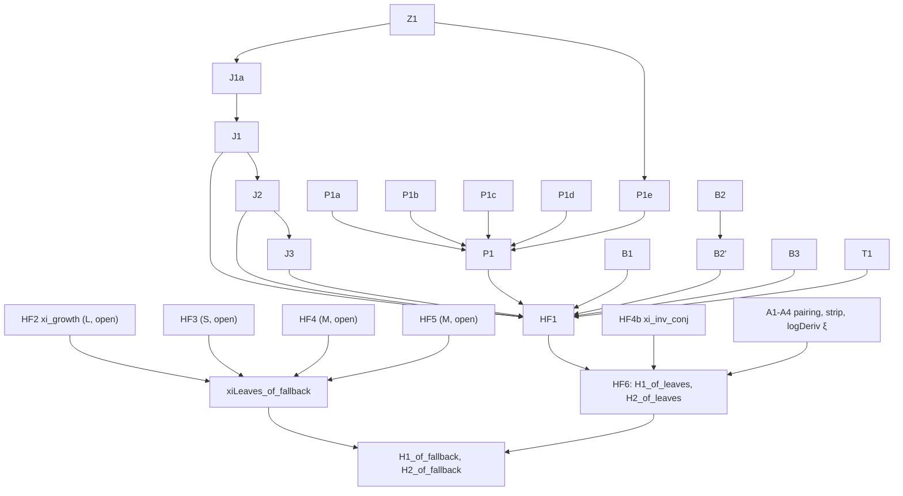

# Blueprint: the Hadamard input H1/H2 in-house

Scope: nodes **H1, H2** of `BLUEPRINT.md` (the real-part partial fractions of `Λ'/Λ(s, χ)` over the
zeros, and their absolute convergence) without importing any outside library.

## 0. Status

| piece | file | status |
|---|---|---|
| **HF1** Hadamard partial fractions, entire `F` of order ≤ 1 | `HadamardHF1.lean` (+ `HadamardHF1Counting`, `HadamardHF1Poisson`, `HadamardHF1Boundary`) | **proved, no `sorry`** |
| **HF4b** conjugation symmetry `ξ(conj s, χ⁻¹) = conj ξ(s, χ)` (new, was missing) | `HadamardAssembly.lean` | **proved, no `sorry`** |
| **HF6** H1 and H2 from the *statements* HF2–HF5 (`H1_of_leaves`, `H2_of_leaves`) | `HadamardAssembly.lean` | **proved, no `sorry`** |
| `H1_of_fallback`, `H2_of_fallback` (verbatim H1, H2) | `HadamardAssembly.lean` | proved from HF2–HF5 of `HadamardFallback.lean`; `sorryAx` enters only through those four leaves |
| **HF2** `xi_growth` (L) | `HadamardFallback.lean` | `sorry` (other worker) |
| **HF3** `xi_differentiable_and_ne_zero` (S) | `HadamardFallback.lean` | `sorry` (other worker) |
| **HF4** `logDeriv_xi_one_sub` (M) | `HadamardFallback.lean` | `sorry` (other worker) |
| **HF5** `analyticOrderNatAt_xi_one_sub_conj` (M) | `HadamardFallback.lean` | `sorry` (other worker) |

`#print axioms` (run on the built modules):

```
Exp7.EF.HF1.logDeriv_eq_add_tsum_of_order_one   [propext, Classical.choice, Quot.sound]
Exp7.EF.HF1.logDeriv_eq_circleAverage_add_sum    [propext, Classical.choice, Quot.sound]
Exp7.EF.Fallback.xi_inv_conj                     [propext, Classical.choice, Quot.sound]
Exp7.EF.Fallback.H1_of_leaves                    [propext, Classical.choice, Quot.sound]
Exp7.EF.Fallback.H2_of_leaves                    [propext, Classical.choice, Quot.sound]
Exp7.EF.Fallback.xiLeaves_of_fallback            [propext, sorryAx, Classical.choice, Quot.sound]
Exp7.EF.Fallback.H1_of_fallback                  [propext, sorryAx, Classical.choice, Quot.sound]
Exp7.EF.Fallback.H2_of_fallback                  [propext, sorryAx, Classical.choice, Quot.sound]
```

So after this work **the only open leaves on the path to H1/H2 are HF2, HF3, HF4, HF5** (one L,
one S, two M). No `axiom`, no `native_decide`. The new files contain no `sorry`.

How to check (from the workspace root, one command at a time):

```
leanq --build Exp7Lean.Analytic.EF.HadamardAssembly     # builds the five new modules
leanq Exp7Lean/Analytic/EF/HadamardAssembly.lean         # or check a single file
```

The only warnings are the `sorry`s of `HadamardFallback.lean`.

## 1. Route for HF1 and why

**Chosen: (ii) the differentiated Poisson–Jensen formula on discs, `R → ∞`.** No canonical
products.

What Mathlib (commit `31ce06ea`, `v4.37.0-rc1`) has, all used and checked:

| need | Mathlib declaration | file |
|---|---|---|
| Jensen's inequality `n(r) ≤ log(M/‖F 0‖)/log(R/r)` | `AnalyticOnNhd.sum_divisor_le` | `Analysis/Complex/JensenFormula.lean` |
| Jensen's formula | `AnalyticOnNhd.circleAverage_log_norm` | same |
| Poisson–Jensen formula at an interior point, zeros on the circle allowed | `MeromorphicOn.log_norm_meromorphicTrailingCoeffAt` | same |
| Blaschke factor `(R² − w̄z)/(R(z − w))` | `Complex.canonicalFactor`, `canonicalFactor_ne_zero`, `analyticOnNhd_canonicalFactor` | `Analysis/Complex/CanonicalDecomposition.lean` |
| Poisson kernel = real part of the Herglotz–Riesz kernel | `poissonKernel_eq_re_herglotzRieszKernel`, `re_circleAverage_herglotzRieszKernel_smul` | `Analysis/Complex/Poisson.lean` |
| derivative of the Herglotz–Riesz integral in the pole | `hasDerivAt_circleAverage_herglotzRieszKernel_smul` | same |
| `log ‖F‖` is circle integrable | `MeromorphicOn.circleIntegrable_log_norm` | `Analysis/SpecialFunctions/Integrability/Log.lean` |
| divisor ↔ order | `MeromorphicOn.AnalyticOnNhd.divisor_apply`, `…divisor_nonneg`, `Nat.cast_analyticOrderNatAt`, `AnalyticOnNhd.analyticOrderAt_ne_top_of_isPreconnected` | `Analysis/Meromorphic/Divisor.lean`, `Analysis/Analytic/Order.lean` |

Why not (i) canonical products: it needs convergence of the genus-1 product, the order of the
product at each zero, a global holomorphic logarithm of the zero-free quotient `F/P`, and
Borel–Carathéodory plus a minimum-modulus estimate for `P` to show `log(F/P)` is linear. None of
that is packaged in Mathlib. Route (ii) needs only an *upper* bound for `‖F‖`, only *local*
logarithms, no infinite products, and (because Mathlib's Poisson–Jensen formula tolerates zeros on
the circle) no choice of "good radii".

### The proof (as formalised)

`F` entire, `F 0 ≠ 0`, `‖F z‖ ≤ exp(C(1+‖z‖)log(2+‖z‖))`; `m ρ = analyticOrderNatAt F ρ`
(`m ρ ≠ 0 ⇔ F ρ = 0`, Z1); `S_R` = the finite set of zeros in `‖ρ‖ < R`.

1. **Counting (J1a, J1).** Jensen's inequality with radii `r < 2r`:
   `∑_{ρ ∈ S, S ⊆ closedBall 0 r} m ρ ≤ log(M/‖F 0‖)/log 2 ≤ A r log(2+r)` for `r ≥ 1`.
2. **Convergence exponent (J2, J3).** Dyadic majorant
   `1/(1+x²) ≤ ∑_{k ≤ K} 4·4^{-k}·1[x ≤ 2^k]` (for `0 ≤ x ≤ 2^K`), swap the two finite sums, apply
   J1 at `r = 2^k`: every finite partial sum of `m ρ/(1+‖ρ‖²)` is at most
   `4 A log 2 ∑_k (k+2) 2^{-k}`. Hence `∑ m ρ/(1+‖ρ‖²) < ∞`, hence only finitely many zeros in each
   ball, hence `∑ ‖m ρ (1/(s−ρ) + 1/ρ)‖ < ∞` (the summand is `≤ 4‖s‖/(1+‖ρ‖²)` for
   `‖ρ‖ > 2‖s‖+1`).
3. **Differentiated Poisson–Jensen (P1).** For `‖w‖ < R`, `F w ≠ 0`:

   `F'/F(w) = (1/2π)∫₀^{2π} 2ζ/(ζ−w)² log‖F ζ‖ dθ + ∑_{ρ ∈ S_R} m ρ (1/(w−ρ) + ρ̄/(R² − ρ̄ w))`, `ζ = Re^{iθ}`.

   Mathlib's Poisson–Jensen formula is an identity between real functions of `w`. Each side is,
   near `w`, the real part of a holomorphic function (P1b: local `log (F z / F w)`; P1c: the
   Herglotz–Riesz integral; P1b again for each Blaschke factor), and two functions that are
   complex differentiable at `w` with the same real part near `w` have the same derivative at `w`
   (P1a, Cauchy–Riemann through the real Fréchet derivative). P1d computes the logarithmic
   derivative of the Blaschke factor.
4. **Error terms (B1–B3).** Subtract P1 at `w = 0` from P1 at `w = s`, same `R ≥ 2‖s‖+1`:

   `F'/F(s) − F'/F(0) − ∑_{ρ ∈ S_R} m ρ (1/(s−ρ) + 1/ρ) = [I_R(s) − I_R(0)] + ∑_{ρ ∈ S_R} m ρ (ρ̄/(R²−ρ̄ s) − ρ̄/R²)`.

   `‖2ζ/(ζ−s)² − 2/ζ‖ ≤ 20‖s‖/R²` on the circle (B2), and the mean of `|log‖F‖|` is
   `≤ A' R log(2+R)` (B1: `|u| ≤ 2K − u` with `K` the upper bound, and the mean of `log‖F‖` is
   `≥ log‖F 0‖` by Jensen); `‖ρ̄/(R²−ρ̄ s) − ρ̄/R²‖ ≤ 2‖s‖/R²` (B3) times `n(R) ≤ A R log(2+R)`.
   Total: `≤ (20A' + 2A)‖s‖ log(2+R)/R → 0`.
5. **Limit (T1).** `∑_{ρ ∈ S_R} → ∑'` by absolute convergence; uniqueness of limits.

Numerical check of P1, B2, B3: `numerics/hadamard_poisson_jensen_check.py` (identity to `1e−15`
at two points for a test function with zeros of multiplicity 1, 2, 3 inside and one outside the
disc; worst observed ratios lhs/rhs for B2 and B3 are `0.60` and `0.98`).

## 2. Node list for HF1 (all proved)

Namespace `Exp7.EF.HF1`. Difficulty is the rating of the node as a task (S ≲ 40 lines, M ≈ 60–200,
L ≈ 250–500); "lines" is what the proof took.

| id | Lean name | file | diff. | depends on | statement |
|---|---|---|---|---|---|
| **Z1** | `analyticOrderNatAt_eq_zero_iff`, `analyticOrderNatAt_ne_zero_iff`, `analyticOrderAt_ne_top_of_entire` | Counting | S | — | entire, `F z₀ ≠ 0`: order finite; `m z = 0 ⇔ F z ≠ 0` |
| **J1a** | `sum_analyticOrderNatAt_le_log_div` | Counting | M | Z1 | `‖F‖ ≤ M` on `‖z‖ = 2r`, `S ⊆ closedBall 0 r` ⇒ `∑_S m ≤ log(M/‖F 0‖)/log 2` |
| **J1** | `sum_analyticOrderNatAt_le` | Counting | S | J1a | `∃ A ≥ 0, ∀ r ≥ 1, ∀ S ⊆ closedBall 0 r, ∑_S m ≤ A r log(2+r)` |
| **J2** | `summable_div_one_add_sq_of_count` (+ `one_div_one_add_sq_le_sum`) | Counting | M | — | counting bound ⇒ `Summable (m ρ/(1+‖ρ‖²))` |
| **J3** | `summable_norm_mul_one_div_sub_add` (+ `finite_setOf_ne_zero_norm_le`, `norm_one_div_sub_add_le`) | Counting | S | — | ⇒ `Summable ‖m ρ (1/(s−ρ)+1/ρ)‖` for every `s` |
| **P1a** | `eq_of_hasDerivAt_of_re_eventuallyEq` | Poisson | S | — | equal real parts near `w` ⇒ equal complex derivatives at `w` |
| **P1b** | `exists_hasDerivAt_re_eq_log_norm` | Poisson | S | — | `f` differentiable at `w`, `f w ≠ 0` ⇒ `log‖f‖ = Re g` near `w` with `g'(w) = f'/f(w)` |
| **P1c** | `exists_hasDerivAt_re_eq_poissonIntegral` | Poisson | S | — | Poisson integral `= Re g` near `w`, `g'(w) = ` mean of `2ζ/(ζ−w)² u(ζ)` |
| **P1d** | `logDeriv_canonicalFactor` | Poisson | S | — | `logDeriv (canonicalFactor R ρ) w = −(1/(w−ρ) + ρ̄/(R²−ρ̄w))` |
| **P1e** | `log_norm_eq_circleAverage_sub_sum` | Poisson | M | Z1 | Poisson–Jensen with a `Finset` of zeros and `analyticOrderNatAt` |
| **P1** | `logDeriv_eq_circleAverage_add_sum` | Poisson | M | P1a–P1e | differentiated Poisson–Jensen formula |
| **B1** | `circleAverage_abs_log_norm_le` | Boundary | M | — | `∃ A ≥ 0, ∀ R ≥ 1`, mean of `\|log‖F‖\|` on `‖ζ‖ = R` is `≤ A R log(2+R)` |
| **B2** | `norm_kernel_sub_le` | Boundary | S | — | `‖2ζ/(ζ−w)² − 2ζ/(ζ−0)²‖ ≤ 20‖w‖/R²` for `‖ζ‖ = R ≥ 2‖w‖` |
| **B2'** | `norm_circleAverage_kernel_sub_le` | Boundary | M | B2 | difference of the boundary integrals `≤ 20‖w‖/R² ·` mean of `\|u\|` |
| **B3** | `norm_reflected_sub_le` | Boundary | S | — | `‖ρ̄/(R²−ρ̄w) − ρ̄/(R²−ρ̄·0)‖ ≤ 2‖w‖/R²` for `‖ρ‖ ≤ R`, `2‖w‖ ≤ R` |
| **T1** | `tendsto_sum_of_exhaustion` | HF1 | S | — | partial sums over an exhaustion of the support tend to the `tsum` |
| **HF1** | `logDeriv_eq_add_tsum_of_order_one` | HF1 | M | all of the above | verbatim the statement in `HadamardFallback.lean` |

Sizes: Counting 329 lines, Poisson 224, Boundary 213, main 174 — **940 lines** including
docstrings, against the earlier estimate of 1,500–3,000. No node turned out larger than M.

Key statements (exact):

```lean
-- P1
theorem logDeriv_eq_circleAverage_add_sum {F : ℂ → ℂ} (hF : Differentiable ℂ F)
    {R : ℝ} (hR : 0 < R) {S : Finset ℂ} (hS : ∀ ρ, ρ ∈ S ↔ ‖ρ‖ < R ∧ F ρ = 0)
    {w : ℂ} (hw : ‖w‖ < R) (hFw : F w ≠ 0) :
    logDeriv F w =
      Real.circleAverage (fun ζ ↦ (2 * ζ / (ζ - w) ^ 2) • ((Real.log ‖F ζ‖ : ℝ) : ℂ)) 0 R
      + ∑ ρ ∈ S, (analyticOrderNatAt F ρ : ℂ) *
          (1 / (w - ρ) + conj ρ / ((R : ℂ) ^ 2 - conj ρ * w))

-- J1
theorem sum_analyticOrderNatAt_le {F : ℂ → ℂ} (hF : Differentiable ℂ F) (h0 : F 0 ≠ 0) {C : ℝ}
    (hgrowth : ∀ z : ℂ, ‖F z‖ ≤ Real.exp (C * (1 + ‖z‖) * Real.log (2 + ‖z‖))) :
    ∃ A : ℝ, 0 ≤ A ∧ ∀ r : ℝ, 1 ≤ r → ∀ S : Finset ℂ, (∀ ρ ∈ S, ‖ρ‖ ≤ r) →
      ∑ ρ ∈ S, (analyticOrderNatAt F ρ : ℝ) ≤ A * r * Real.log (2 + r)

-- B1
theorem circleAverage_abs_log_norm_le {F : ℂ → ℂ} (hF : Differentiable ℂ F) (h0 : F 0 ≠ 0)
    {C : ℝ} (hgrowth : ∀ z : ℂ, ‖F z‖ ≤ Real.exp (C * (1 + ‖z‖) * Real.log (2 + ‖z‖))) :
    ∃ A : ℝ, 0 ≤ A ∧ ∀ R : ℝ, 1 ≤ R →
      Real.circleAverage (fun ζ ↦ |Real.log ‖F ζ‖|) 0 R ≤ A * R * Real.log (2 + R)

-- HF1
theorem logDeriv_eq_add_tsum_of_order_one {F : ℂ → ℂ} (hF : Differentiable ℂ F) (h0 : F 0 ≠ 0)
    (hgrowth : ∃ C : ℝ, ∀ z : ℂ, ‖F z‖ ≤ Real.exp (C * (1 + ‖z‖) * Real.log (2 + ‖z‖))) :
    Summable (fun ρ : ℂ ↦ (analyticOrderNatAt F ρ : ℝ) / (1 + ‖ρ‖ ^ 2)) ∧
    (∀ s : ℂ, Summable (fun ρ : ℂ ↦ ‖(analyticOrderNatAt F ρ : ℂ) * (1 / (s - ρ) + 1 / ρ)‖)) ∧
    ∀ s : ℂ, F s ≠ 0 →
      logDeriv F s = logDeriv F 0 +
        ∑' ρ : ℂ, (analyticOrderNatAt F ρ : ℂ) * (1 / (s - ρ) + 1 / ρ)
```

Remarks on the statement of HF1 (checked while proving it): the growth bound is used only as an
upper bound and only on circles; `C` may have any sign; at a zero `s` the term `ρ = s` of the
series in the second conjunct is `m s · (1/0 + 1/s) = m s / s` in Lean's conventions, which is
harmless; `m 0 = 0` because `F 0 ≠ 0`, so the junk value `1/0` at `ρ = 0` never contributes.

## 3. The assembly HF6: H1 and H2 from HF1–HF5

File `HadamardAssembly.lean`, namespace `Exp7.EF.Fallback`. `ξ = xi χ = N^{s/2} Λ(s, χ)`,
`m ρ = analyticOrderNatAt (xi χ) ρ`.

1. `analyticOrderNatAt_xi`: `m ρ = analyticOrderNatAt χ.completedLFunction ρ` (`N^{s/2}` is
   analytic and nowhere zero; `analyticOrderAt_mul`).
2. Zeros lie in `0 < Re ρ < 1` (`XiLeaves.re_mem_Ioo`): `ξ ≠ 0` on `Re s ≥ 1` is Mathlib's
   `DirichletCharacter.completedLFunction_ne_zero_of_one_le_re`; the left half follows from HF5.
   This strip is what makes `∑ m ρ Re 1/(s−ρ)` *absolutely* convergent:
   `|Re 1/(s−ρ)| ≤ 8(‖s‖+1)/(1+‖ρ‖²)` for `‖ρ‖ > 2‖s‖+2` (`abs_re_one_div_sub_le`), and the first
   conjunct of HF1 gives H2 (`summable_norm_mul_re_one_div_sub`).
3. Pairing (`re_logDeriv_eq_tsum_of_symm`, abstract in `F` and `m`). Take real parts in HF1 and
   split the series (both halves converge absolutely by step 2 at `s` and at `0`):
   `K(s) := Re ξ'/ξ(s) = Re B + A(s) + T`, with `A(s) = ∑ m ρ Re 1/(s−ρ)`, `T = ∑ m ρ Re 1/ρ`.
   Reindexing by the involution `ρ ↦ 1 − conj ρ` (HF5) gives `A(1 − conj s) = −A(s)`; the
   functional equation gives `K(1 − conj s) = −K(s)`. Adding the two instances: `Re B + T = 0`,
   so `K(s) = A(s)`.
4. `K(1 − conj s) = −K(s)` is HF4 **plus the conjugation symmetry**
   `ξ(conj s, χ⁻¹) = conj ξ(s, χ)` (`xi_inv_conj`, **HF4b**).
5. `logDeriv_xi_eq`: for `Re s > 0`, `L(s) ≠ 0`: `ξ(s) ≠ 0` and
   `ξ'/ξ(s) = ½ log N + γ'/γ(s) + L'/L(s)` (`LFunction_eq_completed_div_gammaFactor`,
   `Gammaℝ_ne_zero_of_re_pos`, `differentiable_Gammaℝ_inv`, `logDeriv_mul`).

| id | Lean name | status | depends on |
|---|---|---|---|
| A1 | `summable_norm_mul_re_one_div_sub` | proved | — |
| A2 | `re_logDeriv_eq_tsum_of_symm` | proved | A1 |
| **HF4b** | `xi_inv_conj` (via `LSeries_inv_conj`, `gammaFactor_conj`, `gammaFactor_inv`, `completedLFunction_inv_conj`), `logDeriv_xi_inv_conj` | proved | Mathlib |
| A3 | `analyticOrderNatAt_xi`, `xi_ne_zero_of_one_le_re`, `logDeriv_xi_eq` | proved | Mathlib |
| A4 | `XiLeaves` (structure bundling the statements HF2–HF5), `XiLeaves.re_mem_Ioo`, `XiLeaves.re_logDeriv_one_sub_conj` | proved | HF4b |
| **HF6** | `H1_of_leaves`, `H2_of_leaves : XiLeaves χ → χ ≠ 1 → …` | proved, no `sorry` | HF1, A1–A4 |
| | `xiLeaves_of_fallback` | uses HF2–HF5 | HF2–HF5 |
| | `H1_of_fallback`, `H2_of_fallback` | verbatim H1, H2 | HF6, `xiLeaves_of_fallback` |

The statements are pinned by three `example … := rfl` at the end of the file comparing
`type_of%` of H1/H2 in `HadamardInput.lean` with `H1_of_fallback`/`H2_of_fallback`, and of the
`sorry` leaf HF1 with `Exp7.EF.HF1.logDeriv_eq_add_tsum_of_order_one`.

### Corrections to HF2–HF5

**No statement of HF2–HF5 needs to change.** Checked on paper: HF2 is the standard order-one bound;
HF3 follows from the functional equation at `s = 1` and `completedLFunction_ne_zero_of_one_le_re`;
HF4 holds at every `s` including zeros (both sides are `0` there in Lean's conventions, since
`ξ_χ(1−s) = W(χ) ξ_{χ⁻¹}(s)` as functions); HF5 is true.

**They are not sufficient by themselves**: HF4 speaks about `χ⁻¹`, HF5 only about multiplicities,
and the pairing needs the *value-level* symmetry between `ξ_χ` and `ξ_{χ⁻¹}` (without it one only
gets `Re B(χ) + Re B(χ⁻¹) = −2∑ m ρ Re 1/ρ`, not `Re B(χ)`). That is HF4b, proved in
`HadamardAssembly.lean` from the Dirichlet series on `Re s > 1` and the identity theorem (Mathlib
has `Gammaℝ_conj` and `MulChar.star_apply'` but no conjugation lemma for `LFunction` or
`completedLFunction`). **Whoever proves HF5 can reuse `completedLFunction_inv_conj` / `xi_inv_conj`
instead of redoing it.**

## 4. Dependency graph



**Critical path now:** `HF2 → xiLeaves_of_fallback → H1/H2`. HF2 is the only L node left; HF3–HF5
are independent of it and of each other.

## 5. Wiring into the main development (not done here: it needs edits to files I may not touch)

1. `HadamardFallback.lean`, HF1: add `import Exp7Lean.Analytic.EF.HadamardHF1` and replace the
   `sorry` by `exact Exp7.EF.HF1.logDeriv_eq_add_tsum_of_order_one hF h0 hgrowth`. (Optional:
   `HadamardAssembly.lean` already uses the proved theorem directly, not the `sorry` leaf.)
2. Closing H1/H2 in `HadamardInput.lean` needs the import direction reversed, because
   `HadamardFallback.lean` currently imports `HadamardInput.lean`:
   * change the import of `HadamardFallback.lean` to `import Mathlib` (it uses nothing from
     `HadamardInput`/`Defs`);
   * delete the first two `example`s at the end of `HadamardAssembly.lean` (they mention the
     declarations of `HadamardInput.lean`);
   * in `HadamardInput.lean` add `import Exp7Lean.Analytic.EF.HadamardAssembly` and close the
     two `sorry`s with `exact Fallback.H1_of_fallback χ hχ hne hs hL` and
     `exact Fallback.H2_of_fallback χ hχ hne s`.

   This recipe was compiled on scratch copies of the three files (since deleted); it works as
   written.
3. If the other workers change the *statements* of HF2–HF5, the only place to adapt is
   `xiLeaves_of_fallback` (five fields).

## 6. What is left, and size

| leaf | rating | note |
|---|---|---|
| HF2 `xi_growth` | L (600–1,200 lines est.) | the only substantial piece: `‖L(s,χ)‖ ≤ C(1+‖s‖)` on `Re s ≥ ½` by partial summation, `‖Γ_ℝ(s+a)‖ ≤ exp(C(1+‖s‖)log(2+‖s‖))` on `Re s ≥ ½`, `‖N^{s/2}‖ ≤ exp(‖s‖ log N / 2)`, and the functional equation for `Re s ≤ ½`. A bound valid only for `‖z‖ ≥ R₀` is enough (enlarge `C` on the compact part). Not decomposed here; another worker owns it. These sub-steps are a suggestion, not type-checked statements. |
| HF3 | S | functional equation at `s = 1` + `completedLFunction_ne_zero_of_one_le_re`, `rootNumber_ne_zero` |
| HF4 | M | `ξ_χ(1−s) = W(χ) ξ_{χ⁻¹}(s)` as functions, then differentiate |
| HF5 | M (S–M with HF4b available) | `conj ∘ ξ_χ ∘ (1 − conj ·) = conj W · ξ_χ` from HF4's function identity and `xi_inv_conj`; then the order of `conj ∘ f ∘ (1 − conj ·)` at `ρ` equals the order of `f` at `1 − conj ρ` |

Honest total for H1/H2 in-house: done 1,409 lines (HF1 940, assembly 469); remaining HF2–HF5,
estimated 800–1,600 lines, dominated by HF2. The earlier estimate for the whole of H1/H2
(3,000–5,500 lines) was too high on the HF1 side because Mathlib's Jensen/Poisson–Jensen files do
most of the work.

## 7. Caveats

* I worked on a private copy. `HadamardFallback.lean` there still has all five `sorry`s, with the
  statements quoted in `BLUEPRINT.md`; `H1_of_fallback`/`H2_of_fallback` were checked against
  exactly those statements.
* The new modules are not imported by `Exp7Lean.lean` or `Main.lean` (no existing file was
  edited), so the default `lake build` target does not build them.
* `HadamardHF1*.lean` use `import Mathlib` (as `Exp7Lean/Basic.lean` does); Lake prints a
  "designed for use with the module system" notice for that, which is not an error.
